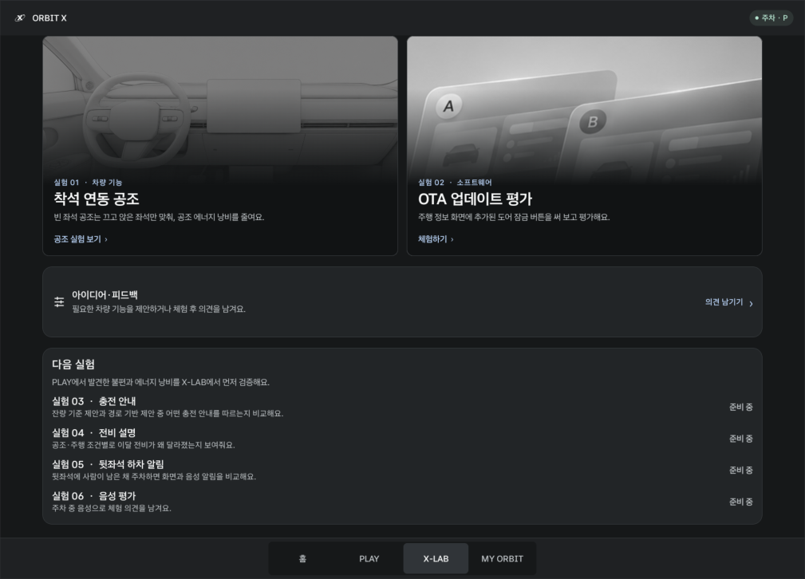

# ORBIT X

> **Every Drive Shapes What's Next.** 모든 주행 경험이 다음 변화를 만듭니다.

**ORBIT X**는 운전자가 차를 쓰면서 드러나는 **불편을 찾아내고, 개선안을 먼저 시험해 보고, 검증된 개선이 OTA로 돌아오게 하는** Pleos Connect 앱입니다. 운전자는 리그·드라이브·미션으로 참여하며 포인트를 받고, 현대자동차그룹은 "무엇이 불편한지, 왜 그런지, 개선이 실제로 나아졌는지"를 근거로 다음 업데이트를 결정합니다. **PLAY는 참여를 만들고, X-LAB은 개선의 근거를 만듭니다.** 현대자동차그룹 차량용 앱 개발 공모전을 위해 만들었습니다.

### 핵심: 불편 발견 → 개선안 → 시험 → 업데이트

| 단계 | ORBIT X에서 하는 일 | 앱의 실제 기능 |
| --- | --- | --- |
| 1. 발견 (PLAY) | 평소 주행에서 차량 신호와 운전자 반응으로 불편·낭비를 찾음 | 주행 효율 리그, 드라이브 리포트, 기능 미션의 미사용 이유, 빈 좌석 공조 감지 |
| 2. 개선안 (X-LAB) | 개선 아이디어를 실제 차량 기능으로 먼저 체험 | 착석 연동 공조(실제 공조 제어), OTA 도어 잠금(실제 도어 제어) |
| 3. 시험 | 기존 방식과 개선안을 같은 과제·같은 차종으로 비교 | A/B 비교(조작 횟수·시간·선호 이유), 사용/미사용 차량 비교, 만족도·계속 사용 의향 |
| 4. 업데이트 | 효과와 만족이 함께 확인된 개선만 OTA로 배포하고, 배포 뒤 PLAY에서 다시 확인 | 리그·장기 미션으로 배포 후 재확인 |

**공조 효율화는 이 순환의 첫 번째 사례일 뿐입니다.** 리그에서 "빈 좌석 공조가 전비를 깎는다"는 불편을 발견하고, X-LAB에서 착석 연동 공조를 시험하고, 효과가 확인되면 OTA로 배포하는 흐름을 처음부터 끝까지 보여주기 위해 골랐습니다. 같은 틀로 도어 잠금 OTA 평가, 주행 중 충전 안내를 이미 구현했고, 지금 Pleos Connect에서 불편한 점(송풍구 방향 조절, 흩어진 주행 정보, Gleo 음성 명령 실패, 화면 멈춤)을 다음 실험으로 올려 두었습니다.

### 이름에 담은 뜻

"운전자의 경험이 차량의 진화로 이어지는 새로운 궤도"

| | 의미 | 담은 생각 |
| --- | --- | --- |
| **ORBIT** | 궤도 · 순환 | PLAY 참여에서 사용자 피드백, 기능 개선, 새로운 차량 경험으로 끊임없이 이어지는 선순환 |
| **X** | eXperience · eXperiment · 확장 | X-LAB에서 새 기능을 먼저 체험하고 검증하며, 사용자 참여로 미래 차량 경험의 가능성을 넓힘 |

운전자의 경험이 데이터로 쌓이고, 그 데이터가 차량의 개선과 새로운 경험으로 되돌아오는 선순환 플랫폼을 지향합니다.

[앱 둘러보기](#앱-둘러보기) · [빌드 및 연결](#빌드-및-연결) · [효율 리그](#주행-효율-리그) · [드라이브](#드라이브) · [공조와 미션](#공조와-미션) · [기록 초기화](#기록-초기화) · [SDK와 검증 범위](#sdk와-검증-범위)

[현재 데이터 처리](#현재-어떤-데이터를-쓰나요) · [현대차그룹의 개발 활용 제안](#향후-차량-개발에-어떻게-쓰나요)

## 앱 둘러보기

| 화면 | 할 수 있는 일 |
| --- | --- |
| **홈** | 회전하는 차량과 시간대별 인사말을 보고, 하단 탭으로 이동합니다. 라이트·다크 표시는 Pleos에서 앱에 전달하는 시스템 테마를 따릅니다. |
| **PLAY** | **주행 효율 리그**에서 월간 추정 전비·연비와 빈 좌석 공조 낭비를 실시간으로 보고, 같은 차종의 착석 연동 공조 사용·미사용 비교(예시)를 확인합니다. **드라이브**에서는 차량 주행가능거리로 왕복 가능 거리를 보고, 순정 내비로 안내를 시작한 뒤 도착하면 이번 드라이브의 거리·사용 에너지·전비 리포트를 받습니다. 데일리·장기 미션에도 참여합니다. |
| **X-LAB** | 사용자 제안이나 개발팀 아이디어를 정식 배포 전에 체험하고 평가하는 공간입니다. 착석 연동 공조는 빈 좌석 공조를 꺼 에너지 낭비를 줄이는 첫 실험이고, OTA 평가에서는 **실제 차량 도어를 SDK로 잠그고 풀며** 업데이트 UX를 평가합니다. 다음 실험으로는 지금 Pleos Connect에서 불편한 점(송풍구 방향 바로 조절, 주행 정보 한곳에, Gleo 음성 명령 실패 표현 수집, 화면 멈춤 바로 신고)을 보여줍니다. |
| **MY ORBIT** | 참여 기록과 포인트를 확인하고, 포인트의 블루멤버스 전환(제휴 후 제공)을 안내합니다. 홈 인사말의 이름을 설정하거나 시연 기록을 초기화합니다. |

### 화면 미리보기

Pleos Connect v2.1.0 에뮬레이터(2560 × 1440)에서 현재 빌드로 캡처했습니다. 앱 영역만 잘랐고, 내비 알림 두 장은 전체 화면입니다.

| 홈 | 주행 효율 리그 |
| --- | --- |
|  |  |
| 슬로건과 인사말, PLAY·X-LAB 진입 | 이달 주행 기록, 빈 좌석 공조 효율 인사이트, 같은 차종 비교(예시), 순위 |
| **드라이브** | **X-LAB** |
|  |  |
| 진행 중 카드(남은 거리·시간·배터리), 드라이브 리포트, 나의 드라이브 기록 | 착석 연동 공조·OTA 평가와 다음 실험 로드맵 |
| **착석 연동 공조** | **OTA 평가(실제 도어 제어)** |
|  |  |
| 빈 차량을 감지해 순정 공조를 끄고 "에너지 절약" 표시 | Vehicle SDK로 네 문을 잠그고 풀며 버튼을 평가 |
| **MY ORBIT** | |
|  | |
| 포인트와 블루멤버스 전환 안내 | |

**주행 중(D) 순정 내비 위 알림 → 경로 주변 충전소**

| 주행 중 충전 경유 제안 | 버튼을 누르면 열리는 순정 내비 충전소 목록 |
| --- | --- |
|  |  |

운전자는 기능을 직접 써 볼 기회와 참여 보상을 받고, 개발팀은 어떤 기능이 필요한지, 어디서 사용이 막혔는지, 새 기능을 계속 쓸 의향이 있는지를 확인할 수 있습니다. 현재 버전은 이 흐름을 기기 안에서 시연합니다.

## 현재 어떤 데이터를 쓰나요?

사용자가 **직접 알려주는 의견**, 차량에서 **SDK로 읽는 상태**, 앱이 **체험 과정에서 계산하는 지표**를 구분합니다. 아래 내용은 현재 프로토타입 기준입니다.

| 기능 | 얻는 데이터와 출처 | 앱에서 쓰는 곳 | 기기에 남기는 내용 |
| --- | --- | --- | --- |
| 홈·MY ORBIT | 사용자가 입력한 표시 이름, 공조 자동화 설정 | 인사말과 내 순위에 같은 이름 표시, 공조 자동화 켜기·끄기 | 표시 이름과 설정 |
| 주행 효율 리그 | 차량 모델, 계기판 누적거리, 전기차 배터리 잔량·충전 스위치, 지원 차량의 연료 잔량 | 차종별 리그 선택, 충전 구간 제외, 월간 전비·연비 계산. 500 km와 유효 효율값을 충족하면 예시 참가자 사이에 내 기록 반영 | 월별 거리 기준점, 효율 계산에 포함된 거리와 소비량 합계, 예시 주행 진행도 |
| 드라이브 리포트 | 출발(P)과 도착(P) 때 읽은 누적거리·배터리 에너지, 차량 주행가능거리(`getRangeRemainingDistance`), 순정 내비의 남은 거리·시간·도착 시 예상 배터리 | 이번 드라이브의 거리·사용 에너지·전비, 이달 평균과 비교, 목적지 왕복 가능 여부와 충전 필요 안내. 충전이 끼면 전비 계산 제외 | 마지막 드라이브의 모드·거리·사용 에너지·충전 여부와 추천 평가 |
| 드라이브 | Pleos 배터리 SOC와 조수석 착석 여부, 사용자가 연결한 순정 내비 목적지·도착 이벤트, 선택한 모드와 도착 후 의견 | 배터리 25% 이하에서는 충전소, 동승자 탑승 시에는 나들이 추천. 실제로 연결해 완료한 목적지가 최근 7일 중 3일 이상 같으면 기분 전환 추천의 근거로 사용 | 진행 중 연결 목적지 이름·주소, 최근 완료 목적지 표시명과 의견. 반복 방문 비교용으로는 목적지 이름 또는 주소를 해시한 값과 방문 날짜를 저장하며, 실제 도착을 기록할 때 최근 7일 범위로 정리 |
| 착석 연동 공조 | Vehicle SDK의 앞뒤 네 좌석 착석 상태, 실내 온도와 차량이 제공하는 공조 상태 | 주차 중 사용자가 자동화를 켰을 때, 지원 구역에 한해 목표 실내온도 23°C를 기준으로 공조 제어 요청 및 적용 상태 표시 | 자동화 설정과 장기 미션 완료일·최종 의견. 좌석 신호나 온도 변화의 연속 이력은 저장하지 않음 |
| X-LAB A/B 비교 | 두 방식에 걸린 시간, 조작 횟수, 오류 횟수, Pleos 착석 신호 또는 시연 입력 여부, 사용자가 고른 방식과 이유 | 기본 조작과 개선안 중 어느 방식이 더 쉽고 선호되는지 같은 과제로 비교 | 최근 실험 결과와 선호·이유 |
| OTA 평가·기능 발견 미션 | Vehicle SDK 도어 잠금 상태와 제어(네 문 전체, P단에서만), 체험 후 평가와 개선 의견, 순정 공조 SYNC 상태 변경, 평소 그 기능을 쓰지 않았던 이유 | 실제 도어를 잠그고 풀어 본 뒤 버튼과 상태 표시를 평가하고, 기능을 몰랐는지·사용법이 어려웠는지·쓸 필요가 없었는지 구분 | 평가 결과, 미션 응답과 포인트 |
| 아이디어·피드백 | 사용자가 선택한 제출 유형과 직접 작성한 제안·체험 의견 | 다음 X-LAB에서 무엇을 검증할지 후보를 모으는 흐름 시연 | 최근 12건의 유형·본문·날짜·지급 포인트 |
| 미션·포인트 | 미션 완료 여부, 완료 날짜, 공조 장기 체험 사용일, 지급 내역 | 장기 미션 진행도, 반복 지급 제한, MY ORBIT 참여 기록 표시 | 잔액, 보상 집계와 기능별 진행·완료 기록 |

현재 ORBIT X는 이 기록을 앱 전용 저장소에 보관합니다. **ORBIT X가 데이터를 전송하는 서버나 현대차그룹에 의견을 전달하는 기능은 없습니다.** 순정 내비 기능을 호출할 때는 Pleos의 내비 연동을 사용합니다. 앱은 연속 GPS 경로, 카메라 영상, 음성을 수집하지 않습니다. 목적지 해시는 같은 장소를 비교하는 용도이며 익명화를 보장하는 값은 아닙니다. 앱 기록은 **MY ORBIT → 기록 관리 → 기록 초기화**에서 지울 수 있습니다. 표시 이름과 공조 자동화 설정은 유지됩니다.

## 향후 차량 개발에 어떻게 쓰나요?

ORBIT X가 제안하는 구조는 **고객 제안 또는 내부 아이디어 → 차량에서 과제로 체험 → 반응과 사용 결과 비교 → 수정·재검증 → 배포 후 평가**입니다. 공조는 이 과정을 보여 주는 첫 번째 예시입니다. 아래 활용은 향후 제안으로, 현재 프로토타입에서 서버로 수집하지 않습니다.

| 개발팀이 답할 질문 | 비교할 지표 | 결과를 사용하는 예 |
| --- | --- | --- |
| 새 기능이 기존 방식보다 편한가? | 과제 완료율, 조작 횟수와 시간의 중앙값, 오류·중단 비율, 개선안 선호율과 이유 | 착석 연동 공조에서 자동 전환이 조작을 줄여도 오작동을 우려한다는 의견이 많다면, 적용 조건과 상태 표시를 먼저 손보고 다시 비교 |
| 기능을 왜 안 쓰는가? | 미사용 이유별 비율: 존재를 몰랐음, 사용법을 몰랐음, 필요를 못 느낌 등. 안내를 본 뒤 체험을 완료한 비율도 확인 | 존재를 몰랐다면 기능을 찾는 경로를, 사용법이 어려웠다면 차량 안 안내를 개선. 필요가 낮다면 배치보다 기능 자체의 우선순위를 재검토 |
| 첫 체험 뒤에도 계속 쓰는가? | 서로 다른 날의 사용 횟수, 7일 완료율, 계속 쓸 의향과 불편 사유 | 첫날 반응은 좋지만 사용이 이어지지 않으면 처음 켜는 과정과 반복 사용 중 불편을 따로 점검 |
| OTA를 적용한 뒤 무엇을 고쳐야 하나? | 버전별 버튼 발견율, 과제 완료율, 주요 불편과 만족 응답. 동일한 과제와 기준으로 비교 | 도어 잠금 버튼 자체는 유용한데 위치를 못 찾는다면 기능을 빼기보다 아이콘과 배치를 수정 |
| 다음에 실험할 기능은 무엇인가? | 제안 주제의 반복 빈도, 문제가 생기는 상황, 기대 효과, 지원 차종·기능 범위 | 같은 문제가 여러 차종에서 반복되면 공통 UI 후보로, 특정 구역이나 옵션에서만 발생하면 차종별 검증 과제로 분리 |

서버 연동 단계에서는 **기능 체험과 개발용 데이터 제공을 구분**하고, 전송 전에 항목과 목적, 보관·삭제 방법을 안내하는 방식을 제안합니다. 개발팀에는 실험 ID와 버전, 과제 결과, 입력 출처, 차종 또는 지원 기능 범주, 선택형 응답 등 판단에 필요한 항목만 보냅니다. 표시 이름, VIN, 원본 목적지와 주행 경로, 좌석 신호의 연속 기록은 개발 분석에 전송하지 않는 것을 원칙으로 합니다. 자유 의견은 사용자가 따로 제출한 경우에만 다루고, 개인정보가 포함된 문장은 분석 대상에서 걸러냅니다. 실차·에뮬레이터·모의 결과도 구분해, 시연 성적을 제품 출시 근거로 섞지 않습니다.

**고객에게는 참여에 대한 보상**, **개발팀에는 개선 여부를 판단할 근거**가 돌아가는 구조입니다. 포인트는 긍정 평가나 특정 답변을 고르는 데 주는 것이 아니라, 정해진 체험과 응답을 완료한 데 주도록 설계합니다. 실제 포인트 전환과 리그 운영은 제휴 및 서버 검증이 필요한 별도 단계입니다.

## 빌드 및 연결

| 항목 | 개발·시연 환경 |
| --- | --- |
| 에뮬레이터 | **Pleos Connect v2.1.0**, Android 14 / API 34, x86_64 |
| 화면 | **2560 × 1440 px**, 160 dpi. Pleos 분할 화면에서 1/3·2/3 앱 영역에 맞춰 배치합니다. |
| 앱 빌드 | Kotlin · Jetpack Compose · Gradle Wrapper 9.6.0 · Gradle 데몬 JVM 25 |
| Android SDK | compile/target API 37 · min API 28. 빌드 SDK와 에뮬레이터 시스템 이미지 버전은 별개입니다. |

1. Android Studio에서 저장소 루트를 열고 SDK Manager에서 **Android SDK API 37**과 **Android SDK Platform-Tools**를 설치합니다. 첫 Gradle 동기화에는 Pleos SDK 의존성을 내려받을 수 있는 네트워크가 필요합니다.
2. [Pleos 공식 개발 가이드](https://document.pleos.ai/docs/connect/guide/getting-started/application-development/use-vehicle-emulator)에 따라 Pleos 가상 기기를 준비합니다. Android Studio **Device Manager**에서 기기를 시작하고 Run 대상으로 선택한 뒤 **app**을 실행합니다.
3. 터미널에서 다음 명령으로 디버그 APK를 빌드하거나, 빌드된 APK를 설치할 수 있습니다.

```powershell
.\gradlew.bat :app:testDebugUnitTest :app:assembleDebug
adb devices
adb -s emulator-5554 install -r --user 10 app/build/outputs/apk/debug/app-debug.apk
adb -s emulator-5554 shell am start --user 10 -n com.example.orbitx/.MainActivity
```

기기 번호와 사용자 번호는 환경에 맞춰 바꿉니다. 활성 사용자 번호는 `adb -s emulator-5554 shell am get-current-user`로 확인합니다. `adb`를 찾을 수 없으면 Android SDK의 `platform-tools` 폴더에서 실행하거나 해당 폴더를 PATH에 추가합니다. Windows 기본 SDK 경로는 `%LOCALAPPDATA%\Android\Sdk`입니다.

**APK 위치:** 위 빌드로 생성되는 시연용 APK는 `app/build/outputs/apk/debug/app-debug.apk`입니다. 제출용 release APK는 현재 저장소에 포함되어 있지 않습니다. 공모전에는 실행 가능한 release APK를 `apk/` 폴더 또는 GitHub Releases에 별도로 등록해야 합니다. [공모전 GitHub 제출 안내](https://appdevchallenge.auto-hmg.io/guide/submission#files)

### 순정 내비가 "서비스 연결 중"에서 멈출 때

에뮬레이터는 PC의 DNS 서버 목록을 그대로 씁니다. VMware·VPN 등 가상 어댑터의 사내 DNS가 앞에 있으면 내비 게이트웨이 주소를 찾지 못해 순정 내비가 연결되지 않습니다. 이때는 에뮬레이터를 공개 DNS로 다시 시작합니다.

```powershell
& "$env:LOCALAPPDATA\Android\Sdk\emulator\emulator.exe" -avd Pleos_Connect_v2.1.0 -no-snapshot-load -dns-server 8.8.8.8,1.1.1.1
```

### Virtual Console 열기

에뮬레이터를 켜 둔 상태에서 포트를 연결한 뒤 PC 브라우저에서 [Pleos Virtual Console](http://127.0.0.1:8088/)을 엽니다. 가상 기기가 하나만 연결돼 있으면 `-s emulator-5554`를 생략할 수 있습니다.

```powershell
adb -s emulator-5554 forward tcp:8088 tcp:8088
```

콘솔에서 **Emulation Controls**를 열고 왼쪽 도메인을 선택하거나 검색창에 아래 카드 이름을 입력합니다. ORBIT X는 에뮬레이터 화면에 띄워 둡니다. [Pleos 콘솔 셋업](https://document.pleos.ai/docs/connect/guide/getting-started/application-development/use-vehicle-emulator)

| 확인할 기능 | 콘솔에서 조작할 카드 | ORBIT X에서 볼 화면 |
| --- | --- | --- |
| 전기차 추정 전비 | **Motion → Odometer**, **Energy → Battery Energy** | PLAY → 주행 효율 리그 |
| 충전 전후 집계 | **Energy → Charge Switch**, **Battery Energy** | PLAY → 주행 효율 리그 |
| 저잔량 추천 | **Energy → Battery SOC** | PLAY → 드라이브 |
| 동승자 추천 및 공조 | **Convenience → Seat Occupancy** | PLAY → 드라이브 또는 X-LAB → 착석 연동 공조 |
| 주행 제한 | **Motion → Gear Selection** | ORBIT X 화면을 띄운 상태에서 P → D → P |
| 앞좌석 SYNC 감지 | Pleos 순정 공조의 **Sync**. 콘솔 **Climate → HVAC Dual**로도 변경을 시도할 수 있습니다. | PLAY → 미션 → 앞좌석 온도 동기화 써보기 |
| 빈 좌석 공조 낭비 감지 | **Climate → Power**(공조 켜기), **Convenience → Seat Occupancy** | PLAY → 주행 효율 리그, X-LAB → 착석 연동 공조 |
| 왕복 가능 거리와 드라이브 리포트 | **Energy → Remaining Range**, **Battery Energy**, **Motion → Odometer** | PLAY → 드라이브 |
| 실제 도어 잠금 | ORBIT X의 **모든 도어 잠그기** 버튼. 콘솔 **Convenience → Door Lock**과 Pleos 상단 자물쇠 아이콘으로 결과 확인 | X-LAB → OTA 업데이트 평가 |
| 모의 도착 | ORBIT X 화면 안의 버튼 | PLAY → 드라이브 |

카드별 설정 범위는 공식 콘솔 가이드에서 확인할 수 있습니다. [Pleos 콘솔 카드 가이드](https://document.pleos.ai/docs/pleos-only/app-test-guide/virtual-console-guide)

**빠른 시연 순서:** P에서 전비 구간 입력 → 동승석 착석 감지와 드라이브 추천 → 착석 연동 공조 켜기 → OTA 평가와 포인트 확인 → D에서 앱 잠금 확인 → P로 복귀.

## 주행 효율 리그

### 아이오닉 5 추정 전비 측정

**PLAY → 주행 효율 리그 → 이달 내 주행 기록**을 띄웁니다. 기어는 **P**에 두면 됩니다. 화면의 **계기판 N km**가 누적거리 기준이고, **이달 주행거리**는 ORBIT X가 이번 달에 집계한 거리입니다.

1. **Energy → Battery Energy**에 **60.0 kWh**를 설정합니다. 카드의 적용 결과를 확인한 뒤 약 5초 기다려 앱이 시작 값을 읽게 합니다.
2. **Motion → Odometer**를 현재 계기판 값보다 **12 km 높게** 설정하고, **Battery Energy**를 **58.0 kWh**로 낮춥니다. 두 값은 어느 쪽부터 바꿔도 됩니다. 앱을 화면에 띄운 상태에서 두 변경을 30초 안에 적용하세요.
3. 몇 초 뒤 **이달 추정 전비**와 계산에 포함된 거리를 봅니다. 기존 월간 측정이 없고 두 변경을 같은 구간으로 읽었다면 **12 km ÷ 2.0 kWh = 6.0 km/kWh**입니다. 기존 측정이 있으면 월간 합계에 더해집니다.
4. 충전을 시연하려면 거리를 그대로 두고 **Energy → Charge Switch → On**을 누른 뒤 약 5초 기다립니다. **Battery Energy**를 **70.0 kWh**로 올리고 **Charge Switch → Off**로 바꾼 뒤 다시 약 5초 기다립니다. 이후 거리를 **6 km** 더 올리고 배터리를 **68.0 kWh**로 낮추면, 위 두 구간의 합계는 **18 km ÷ 4.0 kWh = 4.5 km/kWh**입니다.

충전 중 샘플과 배터리 잔량이 증가한 구간은 소비량에 넣지 않습니다. 충전 후 잔량을 기준으로 새 구간을 계산하고, 이미 쌓인 월간 거리와 전비 기록은 유지합니다. **Charge Port**는 덮개 상태만 표시하므로 열기만 해서는 충전으로 판단하지 않습니다.

**월간 추정 전비 = 유효 구간의 거리 합계 ÷ 같은 구간의 배터리 순사용량 합계**입니다. 그래서 이달 전체 주행거리와 효율 계산에 포함된 거리가 다를 수 있습니다. 500 km는 순위 기준이며, 월이 바뀌면 새 시즌의 거리와 소비량을 별도로 집계합니다.

**Odometer에 HTTP 400이 뜨면** 먼저 앱의 **계기판** 값을 확인하고 그 값보다 큰 정수 km를 입력합니다. 예를 들어 현재 12,000 km면 12,012 km를 사용합니다. 이미 늘린 누적거리를 0으로 되돌리면 이 환경에서 요청이 거절될 수 있습니다. 화면 아래의 슬라이더 숫자만 바뀌고 오류가 남아 있으면 적용된 거리로 보지 말고 앱의 계기판 값으로 확인합니다.

거리만 늘고 전비가 수집 중이면 **Charge Switch가 Off**인지, 배터리 잔량이 실제로 줄었는지 확인하세요. 앱을 벗어났거나 두 변경 사이에 30초가 넘었다면 현재 값에서 새 구간을 만들어 보세요. **Battery SOC**, **Remaining Range**, **Battery Capacity**, **Cruise Target Speed**는 월간 전비 계산에 사용하지 않습니다. Remaining Range는 드라이브의 왕복 가능 거리에만 씁니다.

### 효율 인사이트: 빈 좌석 공조 낭비

리그 화면 오른쪽의 **효율 인사이트**는 주차 중 착석 상태와 공조 구역 전원을 **읽기 전용**으로 확인합니다(차량을 제어하지 않음). 빈 좌석만 있는 구역의 공조가 켜져 있으면 "아무도 없는데 공조가 켜져 있어요"처럼 앰버색으로 알려 주고, **X-LAB 체험**으로 착석 연동 공조를 바로 켤 수 있습니다. 같은 차종 비교의 사용/미사용 전비, 만족도, 계속 사용 비율은 서버 집계가 필요한 **예시 데이터**입니다.

### 가솔린·하이브리드 연비와 순위

지원 차량에서는 **연료량 읽기 허용**을 누른 뒤 AAOS `FUEL_LEVEL` 신호가 들어오면, 월간 관측 거리와 같은 구간의 추정 소비 연료를 사용해 **km/L**를 계산합니다. 예를 들어 12 km를 이동하며 1.0 L를 사용한 구간은 12.0 km/L입니다. 아이오닉 5 기본 Pleos 에뮬레이터의 위 콘솔 카드로는 **km/kWh**를 재현할 수 있습니다. 가솔린·하이브리드 연비 측정에는 연료량을 제공하는 차량 또는 별도 테스트 환경이 필요합니다. [AAOS 차량 속성](https://developer.android.com/reference/android/car/VehiclePropertyIds#FUEL_LEVEL)

- **월 500 km**는 순위 참여를 설명하는 거리 기준입니다. 추정치는 소비량이 충분하면 그 전부터 표시됩니다. 현재 표시 기준은 전기 0.2 kWh 이상, 연료 0.5 L 이상입니다.
- **내 차종 리그**는 월 500 km 이상이고 유효한 월간 추정 전비·연비가 있으면, 저장한 이름과 차량 측정값을 예시 참가자 사이에 자동으로 넣어 순위를 보여줍니다. 기기 안에서 비교하는 순위이며 서버에 등록되지 않습니다. **다른 리그 구경하기**에는 다른 차종의 예시 순위만 나옵니다.
- 리그 예시는 제네시스 **GV90**, 현대 **아이오닉 5**, 현대 **아반떼 N**, 기아 **텔루라이드 하이브리드**입니다. 1·2·3위 시상 예시는 **50,000 / 20,000 / 10,000 P**이며 실제 지급과 연결되지 않습니다.
- 순위만 빠르게 보여주려면 **예시 기록으로 시연 → 예시 주행 +24 km**를 이용합니다. 500 km에 도달하면 저장한 이름과 예시 전비 6.0 km/kWh가 시연 순위에 표시됩니다.
- 월간 거리는 월별 기준점부터 집계합니다. 효율은 연속해서 읽은 구간으로 계산하며 앱이 중단됐거나 신호가 끊긴 동안의 소비량은 소급 계산하지 않습니다.

## 드라이브

1. 기어를 **P**에 두고 **PLAY → 드라이브**를 엽니다.
2. 저잔량 추천을 보려면 **Energy → Battery SOC**를 **20%**로 설정합니다. 앱은 25% 이하에서 **충전 들르기**를 우선 추천합니다.
3. 동승자 추천을 보려면 SOC를 25%보다 높게 바꾸고 **Convenience → Seat Occupancy → Passenger**를 **Occupied**로 설정합니다. 앱은 이때 **동승자와 나들이**를 추천합니다. 배터리가 충분하고 동승자가 없으면 **기분 전환**을 제안하며, 최근 7일 중 3일 이상 같은 목적지에 도착했다면 그 이유도 함께 보여줍니다. 추천은 자동으로 표시되지만 드라이브 시작은 운전자가 선택합니다.
4. **출발 전 확인** 카드에서 차량이 알려 준 주행가능거리(콘솔 **Energy → Remaining Range**)와 왕복 가능 거리를 확인합니다. 주행가능거리를 읽지 못하면 남은 배터리 에너지 × 내 전비로 계산합니다.
5. 모드를 시작한 뒤 **전망대 찾기** 같은 버튼으로 순정 내비 검색을 열거나, **최근 목적지 → 바로 안내**로 앱에서 경로 안내를 시작합니다(NaviHelper `requestRoute`). 안내가 시작되면 ORBIT X가 목적지를 자동으로 연결하고 **남은 거리·시간·도착 시 예상 배터리**와 왕복 가능 여부를 보여줍니다. 왕복이 주행가능거리보다 길면 **주변 충전소 보기**를 제안합니다.
6. 연결된 목적지의 실제 도착 이벤트가 들어오면 도착 기록을 남기고, 출발·도착 때 읽은 누적거리와 배터리 에너지로 **이번 드라이브 리포트**(거리, 사용 에너지, 전비, 이달 평균 대비)를 만듭니다. 리포트에서 "추천이 이번 이동에 맞았나요?"에 답할 수 있습니다.
7. **사용자가 따로 누를 필요가 없게** 만들었습니다. ORBIT X를 한 번 연 뒤에는 순정 내비에서 바로 길 안내를 시작해도 추천 모드로 드라이브가 자동 시작되고, 목적지가 자동 연결되며, 도착 이벤트로 기록이 자동 완료됩니다.
8. **주행 중 내비 위 알림:** 안내 중 도착 시 예상 배터리가 30% 이하이거나 현재 배터리가 25% 이하이면, 순정 내비 화면 위에 "가는 길에 충전소를 경유지로 추가할까요?" 헤드업 알림을 띄웁니다. **충전소 경유**를 누르면 ORBIT X를 열지 않고 순정 내비의 경로 주변 충전소 목록이 열려, 내비에서 바로 경유지로 추가할 수 있습니다. 에뮬레이터 D단에서도 알림 표시와 버튼 동작을 확인했습니다. 시연은 콘솔 **Energy → Battery SOC**를 20% 이하로 낮춘 뒤 내비 안내를 시작하면 됩니다. 수락 여부는 드라이브 리포트에 남습니다.
9. 내비 연결 없이 완료 흐름을 보여주려면 목적지를 연결하기 전에 **도착 시연하기**를 누릅니다. 콘솔에서 Odometer와 Battery Energy를 바꿔 두면 리포트에 그 값이 반영됩니다.

### 드라이브 추천은 어떻게 정하나요?

주차(P) 중 차량 신호를 5초마다 읽고, 위에서부터 처음 맞는 조건으로 추천합니다.

| 순서 | 조건 (데이터 출처) | 추천 |
| --- | --- | --- |
| 1 | 배터리 25% 이하 (Vehicle SDK SOC) | 충전 들르기 |
| 2 | 조수석 착석 (Vehicle SDK 착석 센서) | 동승자와 나들이 |
| 3 | 평일 출퇴근 시간(오전 7시–9시, 오후 5시–7시) | 편한 경로 찾기 (최근 목적지 바로 안내) |
| 4 | 최근 7일 중 3일 이상 같은 목적지 도착 (내비 도착 기록, 목적지는 해시로 저장) | 기분 전환 |
| 5 | 그 외 | 기분 전환 |

실내온도(HVAC 측정값)가 12°C 이하이거나 28°C 이상이면 출발 전 카드에 "실내 난방·냉방 대신 열선·통풍과 착석 연동 공조를 먼저 쓰라"는 효율 팁을 함께 보여줍니다.

**사용자가 귀찮지 않게:** 출발 전에 모드를 고르지 않아도 됩니다. 추천 카드의 버튼으로 내비를 열고 안내를 시작하면 추천 모드로 드라이브가 자동 시작되고, 목적지 연결과 도착 기록도 자동입니다. 실제 목적은 도착 후(P) 리포트에서 **목적 바꾸기**로 한 번만 고치면 됩니다. 주행 중에는 앱 화면을 띄우지 않고, 꼭 필요한 제안만 순정 내비 위 알림으로 보여줍니다. Gleo AI 음성 연동(App Schema)으로 "동승자 모드로 바꿔줘" 같은 음성 조작을 붙이는 것은 확장 계획입니다.

**쌓이는 데이터와 발전 방향:** 드라이브마다 *차량 상황*(배터리, 동승, 주행가능거리, 실내온도) + *선택*(추천 모드 vs 실제 목적, 알림 수락 여부, 실제 거리·에너지) + *이유*(추천이 맞았는지, 기분 한 줄)를 한 묶음으로 기기에 남기고, 추천 수락률을 리포트에 보여줍니다. 다음 단계는 ① 기기 안에서 내 수락·평가 이력으로 추천 순서를 개인화하고, ② 동의한 기록을 서버에서 차종·상황별로 집계해 내비 추천과 충전 안내 UX의 개선 과제를 찾고, ③ X-LAB에서 A/B로 검증한 뒤 OTA로 배포하는 것입니다.

### 나의 드라이브 기록

도착할 때마다 날짜, 장소, 모드, 거리, 전비를 기기에 자동으로 남기고, 리포트에서 탭 한 번으로 그날의 기분 한 줄("또 오고 싶어요", "함께라서 즐거웠어요", "조용히 쉬었어요", "생각보다 아쉬웠어요")을 붙입니다. 드라이브 화면 아래 **나의 드라이브 기록**에서 "11월 14일 · 팔당전망대 · 또 오고 싶어요"처럼 다시 보고, 좌표가 있는 장소는 **다시 가기**로 순정 내비 안내를 바로 시작합니다. 최근 20건만 보관하며 기록 초기화로 지울 수 있습니다.

기어에 따른 화면 전환만 확인하려면 **Motion → Gear Selection**에서 **D**로 바꿔 ORBIT X가 잠기는지 확인한 다음 **P**로 돌아옵니다. 잠금은 ORBIT X 앱 영역 안에서 동작합니다. 실제 내비의 목적지 연결과 도착 이벤트는 에뮬레이터의 내비 서비스 상태에 따라 달라집니다.

## 공조와 미션

| 분류 | 미션 | 시연 보상 |
| --- | --- | ---: |
| 데일리 | 도어 잠금 업데이트 평가 | 2,000 P |
| 데일리 | 나에게 맞는 드라이브 | 1,000 P |
| 데일리 | 동승자 탑승 공조 비교 | 1,000 P |
| 데일리 | 앞좌석 온도 동기화 써보기 | 1,000 P |
| 장기 | 착석 연동 공조 7일 써보기 | 3,000 P |

표는 처음 완료할 때 받을 수 있는 포인트입니다. 같은 미션의 완료 내역과 지급 한도에 따라 받을 수 있는 값은 달라집니다. 드라이브 적립은 주 2회, 앱 내 적립은 월 80,000 P까지입니다. **데일리**는 하루 안에 해볼 수 있는 미션 묶음이며, 모든 평가가 매일 초기화되는 것은 아닙니다.

### 착석 연동 공조

1. **Motion → Gear Selection**을 **P**로 둡니다.
2. **X-LAB → 착석 연동 공조 → 자동 공조**에서 **착석 연동 공조** 스위치를 켭니다.
3. 콘솔 **Convenience → Seat Occupancy**에서 운전석과 동승석을 **Empty**에서 **Occupied**로 한 자리씩 바꿉니다. 뒷좌석도 좌우를 따로 확인할 수 있습니다.
4. ORBIT X의 좌석별 착석 표시와 **A/C ON/OFF**를 확인합니다. 네 좌석의 착석과 실내 목표 **23°C**를 기준으로, 주차 중 SDK가 지원하는 공조와 좌석 기능에 제어를 요청합니다. 같은 공조 구역을 공유하는 좌석은 함께 반응할 수 있으며, 실제 반영 여부는 앱 표시와 순정 공조에서 확인합니다.
5. 장기 미션의 첫날을 보여주려면 주차 중 자동 제어를 켜고, 착석한 구역의 공조가 확인된 상태로 이 화면을 **1분간** 유지합니다. **PLAY → 미션**에서 진행도를 확인합니다. 하루 한 번, 서로 다른 7일을 기록한 뒤 의견을 제출하는 미션입니다.

### 수동 전환과 자동 전환 비교

**X-LAB → 착석 연동 공조 → 개선안 비교 → A/B 비교 시작**을 선택합니다. 앱에 표시된 순서로 두 방식을 진행합니다.

- **수동 전환**은 화면의 탑승·하차 시연과 앞좌석 전체·운전석 전용 변경 버튼을 사용합니다.
- **자동 전환**은 콘솔에서 동승석을 먼저 **Empty**로 두고, 화면 안내에 맞춰 **Occupied**, 다시 **Empty**로 바꿉니다. 화면의 **탑승 시연**과 **하차 시연**으로도 완료할 수 있습니다.
- 두 방식을 마친 뒤 선호와 이유를 선택하면 조작 횟수와 시간이 기록됩니다. 비교 화면의 공조 전환은 앱 내 시연입니다.

### 앞좌석 SYNC와 도어 잠금 OTA

- **앞좌석 온도 동기화**는 **PLAY → 미션 → 앞좌석 온도 동기화 써보기**에서 현재 상태가 표시될 때까지 기다립니다. Pleos 하단의 온도 숫자를 눌러 순정 공조를 열고 **Sync**를 한 번 바꿉니다. 앱에서 **SYNC 변경 확인**이 뜨면 이유를 선택하고 응답을 제출합니다.
- **도어 잠금 OTA**는 **X-LAB → OTA 업데이트 평가** 또는 PLAY 미션에서 엽니다. **업데이트 후** 화면에서 **모든 도어 잠그기**와 **잠금 해제**를 한 번씩 누르면 Vehicle SDK(`Door.setDoorLock`)로 실제 네 문의 잠금이 바뀌고, 차량이 보고한 상태를 다시 읽어 표시합니다. P단에서만 동작하며, 도어 상태를 읽을 수 없는 환경에서는 앱 내 체험으로 전환됩니다. 두 동작을 모두 해 본 뒤 평가를 제출합니다.
- **아이디어·피드백**은 **X-LAB → 아이디어·피드백**에서 의견을 작성하고 제출합니다. 시연 포인트와 제출 내역은 **MY ORBIT**에서 확인합니다.

## 기록 초기화

**MY ORBIT → 기록 관리 → 기록 초기화**를 누르고 확인 창에서 **초기화**를 선택합니다. 미션 진행 및 완료 내역, 체험 의견, 시연 포인트, 앱의 이달 주행·리그 기록이 초기화됩니다. 저장한 이름과 착석 연동 공조 설정은 유지됩니다. 다음 측정은 콘솔에서 현재 계기판 값부터 시작합니다.

## SDK와 검증 범위

| 연동 | 사용하는 신호와 화면 |
| --- | --- |
| Pleos Vehicle SDK 2.3.2 | 기어·착석, 지원 구역의 공조 읽기·제어(빈 좌석 공조 끄기 포함), 누적거리·주행가능거리, 배터리 잔량·에너지·충전 스위치, **도어 잠금 상태 읽기·제어**, 차량 제공 효율 참고값 |
| Pleos NaviHelper 3.0.5 | 순정 내비 화면 요청(주행 중 알림에서 경로 주변 충전소 열기 포함), **앱에서 경로 안내 시작(`requestRoute`)**, 최근 목적지, 경로 시작·남은 거리·시간·도착 시 예상 배터리, 드라이브 자동 시작과 목적지 자동 연결, 도착 이벤트 |
| Android Automotive OS | 주행 제한, 차량 모델, 지원 차량의 연료량 |

도어 잠금 OTA 평가는 실제 도어를 제어하지만, 차량 소프트웨어를 설치하지는 않습니다. 시연 순위, 같은 차종 사용/미사용 비교 수치, 내비 없이 하는 모의 도착은 앱에서 재현합니다. 실차 연료량 기반 연비는 추가 검증이 필요합니다. 월간 전비 계산은 신호가 따로 도착하는 경우, 충전 구간을 빼는 경우, 신호가 끊겼다가 다시 들어오는 경우를 단위 테스트로 검증합니다.


차량별 월간 서버 순위와 사용/미사용 실측 비교, 블루멤버스 포인트 실제 전환은 향후 제안입니다. 주행 중 알림은 현재 충전 경유 제안 한 가지이며, 휴게·동승자 코스 제안과 음성(TextToSpeech) 안내는 확장 계획입니다. [Pleos Connect SDK](https://document.pleos.ai/en/api-reference/connect-sdk-pleos) · [NaviHelper](https://document.pleos.ai/api-reference/connect-sdk-pleos/NaviHelper/intro)
