# ORBIT X

> **Every Drive Shapes What's Next.** 모든 주행 경험이 다음 변화를 만듭니다.

**ORBIT X**는 운전자가 차를 쓰면서 드러나는 **불편을 찾아내고, 개선안을 먼저 시험해 보고, 검증된 개선이 OTA로 돌아오게 하는** Pleos Connect 앱입니다.
**PLAY는 참여를 만들고, X-LAB은 개선의 근거를 만듭니다.** 현대자동차그룹 차량용 앱 개발 공모전 출품작입니다.

| 한눈에 보기 | |
| --- | --- |
| 앱 | ORBIT X · Android Automotive (Kotlin, Jetpack Compose) |
| 개발·테스트 환경 | **Pleos Connect v2.1.0 에뮬레이터** · Android 14 (API 34) · x86_64 · **2560 × 1440 px, 160 dpi** |
| 사용 SDK | Pleos Vehicle SDK 2.3.2 · Pleos NaviHelper 3.0.5 · Android Automotive OS API |
| 실행 방법 | [실행 방법](#실행-방법) 참고 |
| APK | 제출용 release APK는 `apk/` 폴더에 올릴 예정입니다. 시연용 debug APK는 `app/build/outputs/apk/debug/app-debug.apk`로 빌드됩니다. |

**목차** · [핵심 아이디어](#핵심-아이디어) · [화면 미리보기](#화면-미리보기) · [기능](#기능) · [실행 방법](#실행-방법) · [시연 가이드](#시연-가이드) · [데이터와 개인정보](#데이터와-개인정보) · [향후 활용](#향후-차량-개발에-어떻게-쓰나요) · [구현 범위](#구현-범위와-sdk)

---

## 핵심 아이디어

### 불편 발견 → 개선안 → 시험 → 업데이트

| 단계 | ORBIT X에서 하는 일 | 앱의 실제 기능 |
| --- | --- | --- |
| **1. 발견** (PLAY) | 평소 주행에서 차량 신호와 운전자 반응으로 불편·낭비를 찾음 | 주행 효율 리그, 드라이브 리포트, 미션의 미사용 이유, 빈 좌석 공조 감지 |
| **2. 개선안** (X-LAB) | 개선 아이디어를 실제 차량 기능으로 먼저 체험 | 착석 연동 공조(실제 공조 제어), OTA 도어 잠금(실제 도어 제어) |
| **3. 시험** | 기존 방식과 개선안을 같은 과제·같은 차종으로 비교 | A/B 비교(조작 횟수·시간·선호 이유), 사용/미사용 차량 비교, 만족도·계속 사용 의향 |
| **4. 업데이트** | 효과와 만족이 함께 확인된 개선만 OTA로 배포하고, 배포 뒤 다시 확인 | 리그·장기 미션으로 배포 후 재확인 |

운전자는 리그·드라이브·미션으로 참여하며 포인트를 받고, 현대자동차그룹은 **무엇이 불편한지, 왜 그런지, 개선이 실제로 나아졌는지**를 근거로 다음 업데이트를 결정합니다.

> **공조 효율화는 이 순환의 첫 번째 사례일 뿐입니다.** 리그에서 "빈 좌석 공조가 전비를 깎는다"는 불편을 발견하고, X-LAB에서 착석 연동 공조를 시험하고, 효과가 확인되면 OTA로 배포하는 흐름을 처음부터 끝까지 보여주기 위해 골랐습니다. 같은 틀로 도어 잠금 OTA 평가와 순정 충전 안내를 개선하는 실험(도착 배터리 기준 내비 위 알림)을 구현했고, 지금 Pleos Connect에서 불편한 점(송풍구 방향 조절, 여러 화면에 겹치는 주행 정보, Gleo 음성 명령 실패)을 다음 실험으로 올려 두었습니다. 모든 실험은 리그와 드라이브 리포트 질문을 공통으로 쓰고 실험마다 PLAY 하나만 더합니다.

### 이름에 담은 뜻

"운전자의 경험이 차량의 진화로 이어지는 새로운 궤도"

| | 의미 | 담은 생각 |
| --- | --- | --- |
| **ORBIT** | 궤도 · 순환 | 참여 → 피드백 → 기능 개선 → 새로운 차량 경험으로 이어지는 선순환 |
| **X** | eXperience · eXperiment · 확장 | X-LAB에서 새 기능을 먼저 체험하고 검증하며 미래 차량 경험을 넓힘 |

---

## 화면 미리보기

Pleos Connect v2.1.0 에뮬레이터에서 현재 빌드로 캡처했습니다. 기록을 초기화한 뒤 Virtual Console로 주행 한 번(18 km, 배터리 60 → 57 kWh)을 넣어 리그와 드라이브 값을 만들었습니다. 앱 화면은 앱 영역만 잘랐고, 내비 화면은 전체 화면입니다.

| 홈 | 주행 효율 리그 |
| --- | --- |
| 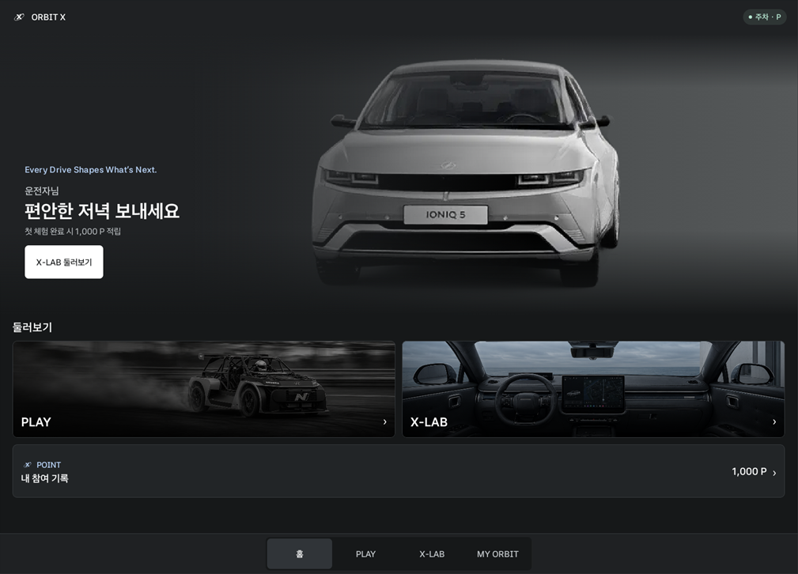 | 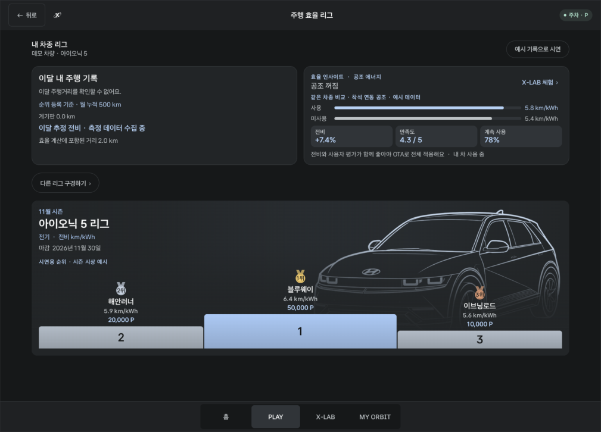 |
| 슬로건과 인사말, PLAY·X-LAB 진입, 포인트 | 이달 주행 18 km·추정 전비 6.0 km/kWh, 공조 인사이트와 같은 차종 비교(예시), 순위(예시) |
| **드라이브** | **X-LAB** |
| 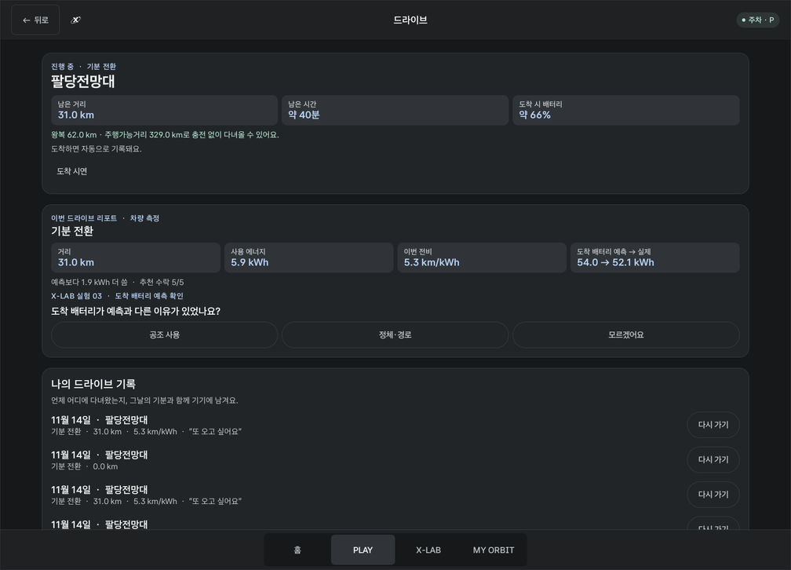 | 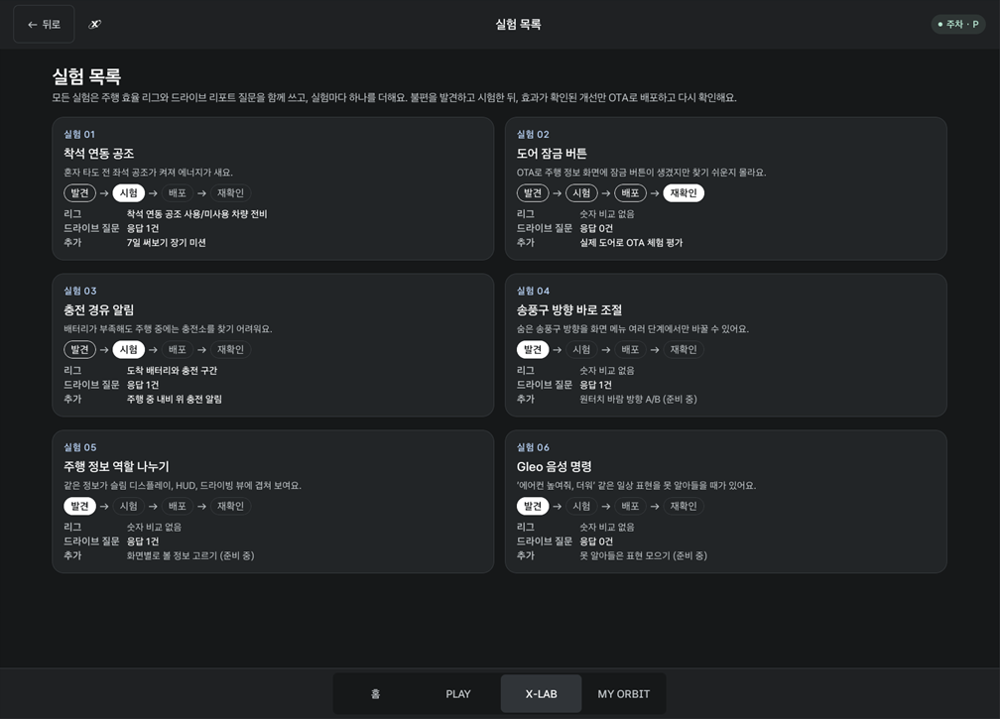 |
| 드라이브 리포트(18 km · 3 kWh · 6.0 km/kWh), X-LAB 실험 질문, 나의 드라이브 기록 | X-LAB → 실험 목록: 실험 6개의 단계(발견 → 시험 → 배포 → 재확인)와 연결된 PLAY, 응답 수 |
| **착석 연동 공조** | **OTA 평가 (실제 도어 제어)** |
| 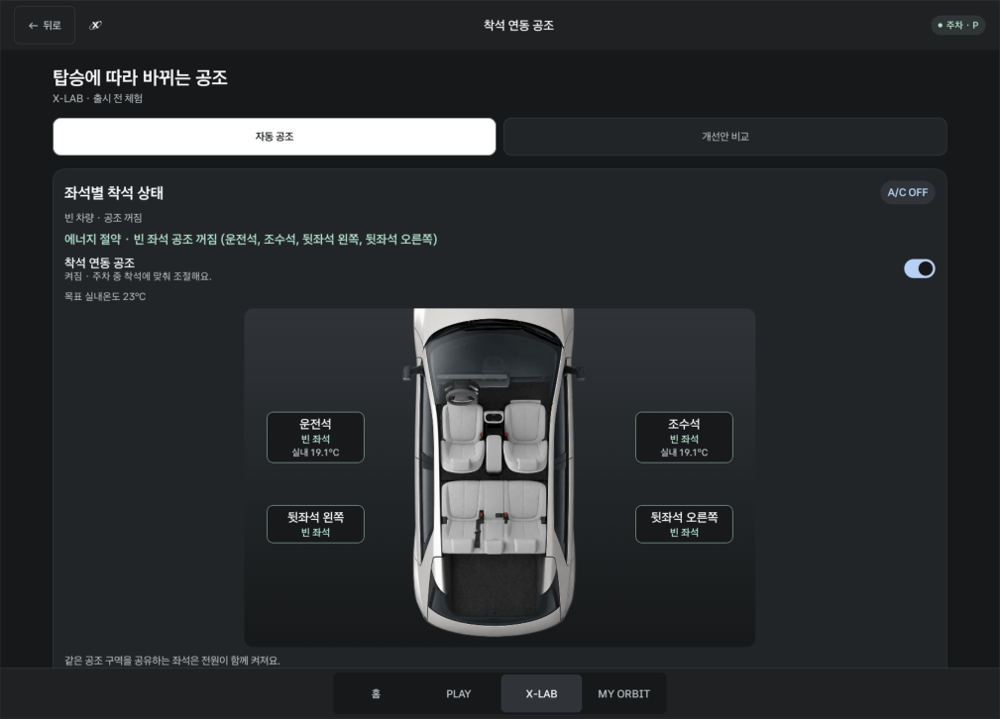 | 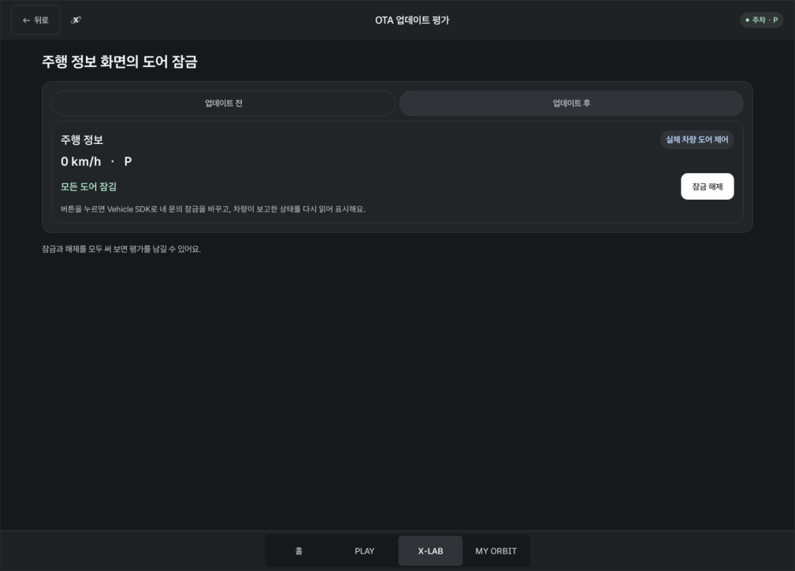 |
| 빈 차량을 감지해 순정 공조를 끄고 "에너지 절약" 표시 | Vehicle SDK로 네 문을 잠그고 풀며 버튼을 평가 |
| **MY ORBIT** | **개선안 비교 (실제 차량 A/B)** |
| 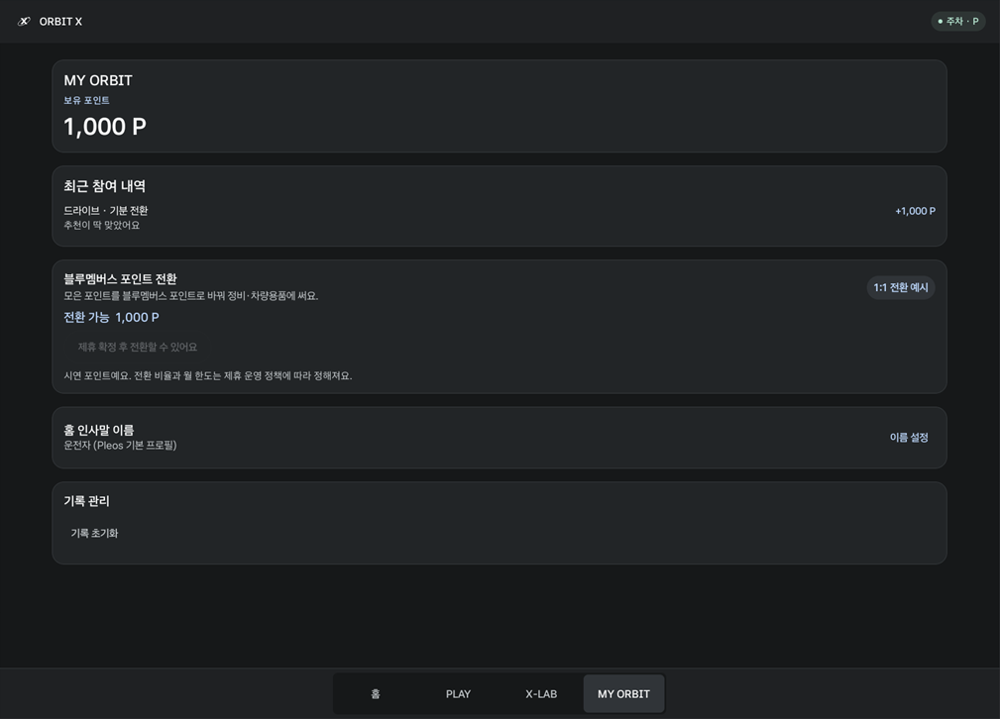 | 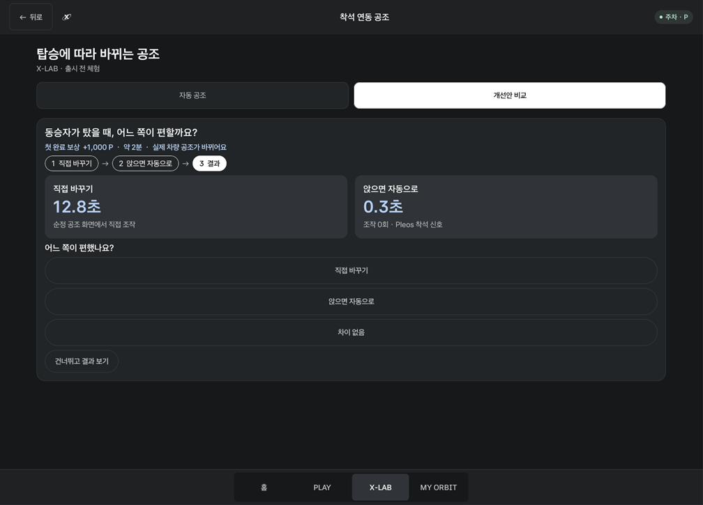 |
| 포인트와 블루멤버스 전환 안내 | 순정 공조로 직접 SYNC 켜기 vs 착석하면 자동으로, 운전자가 손대야 하는지 비교 |

### 주행 중 (기어 D)

| 앱 화면 잠금 | 순정 내비 위 충전 경유 알림 | 알림 버튼 → 순정 내비 충전소 목록 |
| --- | --- | --- |
| 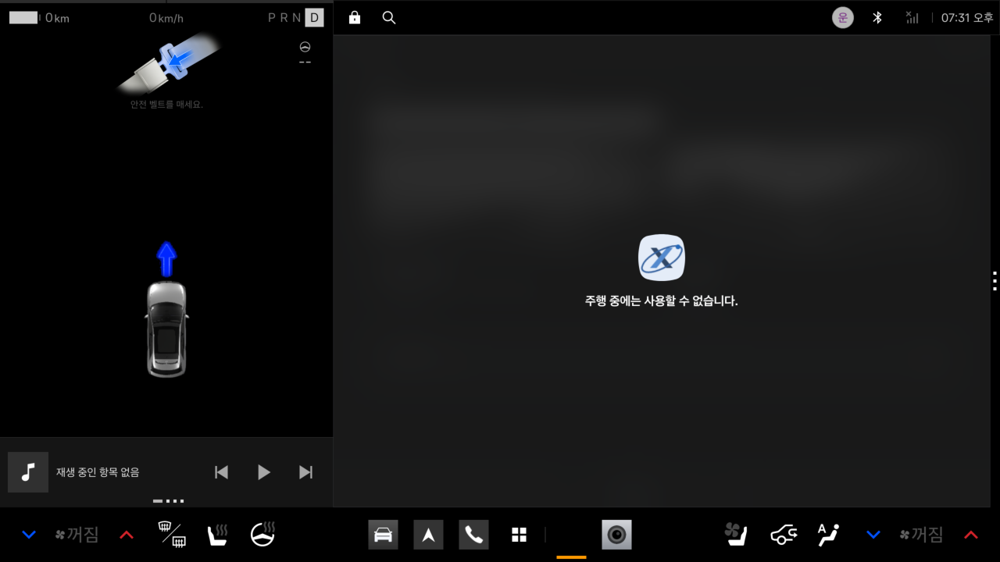 | 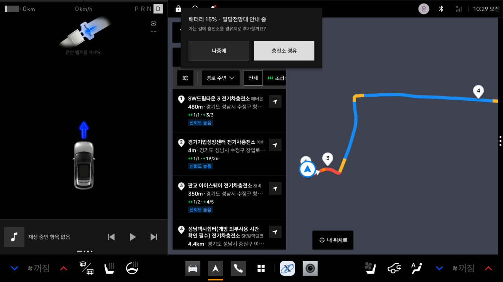 | 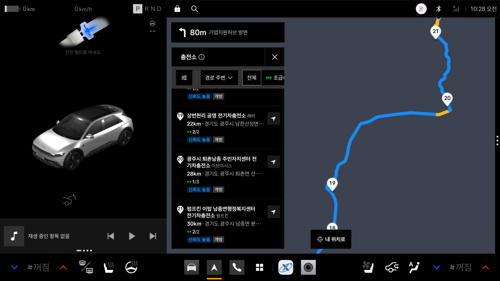 |
| Pleos 주행 제한에 따라 "주행 중에는 사용할 수 없습니다." 표시. P로 돌아오면 다시 조작 | 앱을 열지 않고 내비 위에 제안 | 경로 주변 충전소를 고르면 내비가 경유지로 추가 |

### 도착 후 (기어 P)

| 내비 위 X-LAB 실험 질문 |
| --- |
| 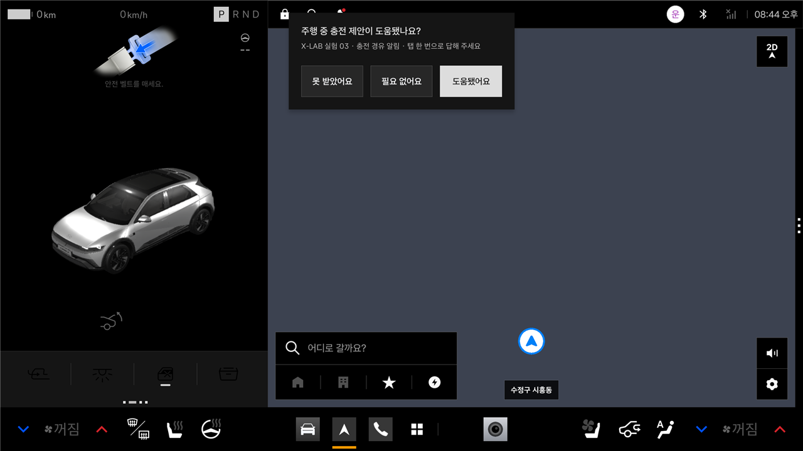 |
| 도착 후 주차하면 이번 드라이브의 실험 질문을 내비 위에 띄웁니다. 앱을 다시 열지 않고 버튼 하나로 답하고, 응답은 X-LAB 실험 카드에 쌓입니다. 주행 중에는 띄우지 않습니다. |

---

## 기능

표시 기준: **실제 SDK** = 차량·내비에서 실제로 읽거나 제어 · **예시** = 서버 집계가 필요해 시연용 값 사용

### PLAY · 발견

**주행 효율 리그**
- 같은 차종끼리 월간 추정 전비(km/kWh)·연비(km/L)를 비교합니다. 누적거리와 배터리 에너지로 계산하고 충전 구간은 뺍니다. 주행 중 내비가 앞에 있어 앱이 뒤로 가도 백그라운드 서비스가 계속 기록합니다. **실제 SDK**
- **효율 인사이트:** 주차 중 착석과 공조 구역 전원을 읽기 전용으로 확인해, 빈 좌석에 공조가 켜져 있으면 앰버색으로 알려 줍니다. **실제 SDK**
- **같은 차종 비교:** 착석 연동 공조 사용/미사용 차량의 전비와 만족도·계속 사용 비율. **예시**
- 순위·경쟁자·시상액. **예시**

**드라이브**
- **출발 전 확인:** 차량 주행가능거리로 왕복 가능 거리, 배터리, 실내온도를 보여주고, 너무 춥거나 더우면 열선·착석 연동 공조 팁을 줍니다. **실제 SDK**
- **자동으로 흘러가는 드라이브:** 순정 내비에서 안내를 시작하면 추천 모드로 드라이브가 자동 시작되고, 목적지가 자동 연결되며, 도착 이벤트로 기록이 자동 완료됩니다. **실제 SDK**
- **경로 에너지 확인:** 남은 거리·시간·도착 시 예상 배터리를 보여주고, 왕복이 주행가능거리보다 길면 충전소를 제안합니다. **실제 SDK**
- **주행 중 내비 위 알림 (순정 안내 개선 실험):** 순정 내비에도 저잔량 충전 안내가 있습니다. ORBIT X는 이를 대신하지 않고, 안내 중인 경로의 **도착 예상 배터리**를 기준으로 알리는 방식을 시험합니다. 도착 배터리가 30% 이하이거나 현재 25% 이하이면 순정 내비 위에 "충전소를 경유지로 추가할까요?"를 띄우고, 버튼 하나로 경로 주변 충전소 목록을 엽니다. 기어 D에서도 동작을 확인했습니다. **실제 SDK**
- **드라이브 리포트:** 출발·도착 때 읽은 값으로 거리·사용 에너지·전비를 계산합니다. 질문은 한 번에 하나(기분 한 줄 → 추천이 맞았는지 → X-LAB 실험 질문 하나)만 묻고(실험 질문은 도착 후 내비 위 알림으로도 답할 수 있음), 실제 목적은 도착 후 **목적 바꾸기**로 고칩니다. **실제 SDK**
- **나의 드라이브 기록:** 날짜·장소·거리·전비와 기분 한 줄을 남기고, **다시 가기**로 순정 내비 안내를 바로 시작합니다. 최근 20건을 기기에 보관합니다.

<details>
<summary>드라이브 추천은 어떻게 정하나요?</summary>

주차(P) 중 차량 신호를 5초마다 읽고, 위에서부터 처음 맞는 조건으로 추천합니다.

| 순서 | 조건 (데이터 출처) | 추천 |
| --- | --- | --- |
| 1 | 배터리 25% 이하 (Vehicle SDK SOC) | 충전 들르기 |
| 2 | 조수석 착석 (Vehicle SDK 착석 센서) | 동승자와 나들이 |
| 3 | 평일 출퇴근 시간 (오전 7시–9시, 오후 5시–7시) | 편한 경로 찾기 |
| 4 | 최근 7일 중 3일 이상 같은 목적지 도착 (목적지는 해시로 저장) | 기분 전환 |
| 5 | 그 외 | 기분 전환 |

드라이브마다 **차량 상황**(배터리, 동승, 주행가능거리, 실내온도) + **선택**(추천 모드 vs 실제 목적, 알림 수락 여부, 실제 거리·에너지) + **이유**(추천이 맞았는지, 기분 한 줄)를 한 묶음으로 남기고 추천 수락률을 보여줍니다. 다음 단계는 ① 내 이력으로 추천 순서를 기기 안에서 개인화하고, ② 동의한 기록을 서버에서 차종·상황별로 집계해 개선 과제를 찾고, ③ X-LAB에서 검증한 뒤 OTA로 배포하는 것입니다. 출퇴근 시간도 설정 화면 대신 드라이브 기록의 반복 패턴에서 배우는 방향을 제안합니다.

</details>

**미션**
- 데일리·장기 미션으로 기능을 써 보게 합니다. 예를 들어 SYNC 미션은 순정 SYNC를 실제로 켜 본 뒤 그동안 쓰지 않은 이유(몰랐음 / 사용법 모름 / 필요 없음)를 묻습니다. **실제 SDK**

| 분류 | 미션 | 시연 보상 |
| --- | --- | ---: |
| 데일리 | 도어 잠금 업데이트 평가 | 2,000 P |
| 데일리 | 나에게 맞는 드라이브 | 1,000 P |
| 데일리 | 동승자 탑승 공조 비교 | 1,000 P |
| 데일리 | 앞좌석 온도 동기화 써보기 | 1,000 P |
| 장기 | 착석 연동 공조 7일 써보기 | 3,000 P |

처음 완료할 때의 포인트이며, 드라이브 적립은 주 2회, 앱 내 적립은 월 80,000 P까지입니다.

### X-LAB · 개선안과 시험

- **착석 연동 공조:** 네 좌석의 착석을 읽어 빈 좌석 공조는 끄고, 앉은 좌석은 목표 23°C와 열선·통풍으로 맞춥니다. 좌석별 풍량을 지원하는 차는 빈 좌석 바람을 가장 약하게(지원 시 0단) 줄이고, 앞좌석 풍량이 하나로 묶인 차(에뮬레이터)는 빈 좌석 온도만 절전으로 맞춥니다. 모두 비면 순정 공조를 끕니다. 낭비가 보이면 **빈 좌석 공조 끄기** 버튼 하나로 켤 수 있습니다. **실제 SDK**
- **개선안 비교(A/B):** "동승자가 탔을 때 앞좌석 온도를 함께 맞추기"를 실제 차로 두 번 합니다. ① **직접 바꾸기**는 순정 공조 화면에서 SYNC를 켜고, ② **앉으면 자동으로**는 동승석 착석을 감지한 앱이 SYNC를 켭니다. 두 번 모두 차량이 보고한 SYNC 상태로 완료를 확인하고, ③ 결과에서 운전자가 직접 조작해야 했는지를 나란히 비교한 뒤 선호와 이유를 남깁니다. 보통 공조는 켜 둔 채 덥거나 추울 때만 조절하므로, 빠르기보다 동승자가 탔을 때 운전자가 손댈 일이 줄어드는지를 봅니다. **실제 SDK**
- **OTA 업데이트 평가:** "모든 도어 잠그기 / 잠금 해제"를 누르면 Vehicle SDK로 **실제 네 문의 잠금**을 바꾸고, 차량이 보고한 상태를 다시 읽어 표시합니다. P단에서만 동작합니다. **실제 SDK**

**실험 목록: 공통 PLAY 2개 + 실험마다 하나**

모든 실험은 **주행 효율 리그**(숫자로 효과 측정)와 **드라이브 리포트 질문**(도착 직후 이유 수집)을 함께 쓰고, 실험마다 PLAY를 하나만 더합니다. 드라이브마다 실험 질문을 하나씩 돌려 가며 묻습니다. 도착 후 주차하면 **내비 위 알림 버튼**으로 앱을 열지 않고 답할 수 있고, 앱의 드라이브 리포트에서도 답할 수 있습니다. 응답 수는 **X-LAB → 실험 목록**의 실험 카드에 쌓입니다. 실험 하나는 설정 묶음(단계, 리그 지표, 드라이브 질문, 추가 PLAY)이라 새 실험을 넣어도 PLAY 화면을 고칠 필요가 없습니다. 운영 단계에서는 이 설정을 서버에서 내려보냅니다.

| 실험 | 불편·낭비 | 리그 | 드라이브 질문 | 추가 PLAY | 단계 |
| --- | --- | --- | --- | --- | --- |
| 01 착석 연동 공조 | 혼자 타도 전 좌석 공조가 켜짐 | 사용/미사용 차량 전비 | 공조가 쾌적했나요? | 7일 장기 미션 | 시험 |
| 02 도어 잠금 버튼 | OTA로 생긴 버튼을 찾기 쉬운지 모름 | - | 잠금 버튼을 바로 찾았나요? | 실제 도어 OTA 체험 평가 | 재확인 |
| 03 충전 안내 개선 | 순정 저잔량 안내가 주행 중 언제·어떻게 알려야 도움이 되는지 모름 | 도착 배터리, 충전 구간 | 충전 안내가 도움됐나요? | 도착 배터리 기준 내비 위 알림 | 시험 |
| 04 송풍구 방향 바로 조절 | 숨은 송풍구를 화면 메뉴 여러 단계로만 조절 | - | 바람 방향 바꾸다 불편했나요? | 원터치 바람 방향 A/B (준비 중) | 발견 |
| 05 주행 정보 역할 나누기 | 같은 정보가 슬림 디스플레이·HUD·드라이빙 뷰에 겹침 | - | 여러 화면에 보여 헷갈렸나요? | 화면별 볼 정보 고르기 (준비 중) | 발견 |
| 06 Gleo 음성 명령 | "에어컨 높여줘, 더워" 같은 일상 표현 인식 실패 | - | 못 알아들은 말이 있었나요? | 못 알아들은 표현 모으기 (준비 중) | 발견 |


### MY ORBIT · 보상

- 참여 기록과 포인트, 블루멤버스 포인트 전환(제휴 후 제공)을 안내합니다.

**왜 블루멤버스 포인트로 바꿔 주나요?**

| 관점 | 이유 |
| --- | --- |
| 운전자 | 앱 안에서만 쓰는 포인트는 쓸 곳이 없어 금방 관심이 식습니다. 이미 가입해 쓰는 블루멤버스로 바꾸면 정비·차량용품처럼 차에 실제로 쓰는 혜택이 되어 참여할 이유가 생깁니다. |
| 현대자동차그룹 | 새 포인트 제도나 별도 정산 체계를 만들 필요 없이 기존 멤버십을 그대로 씁니다. 지급한 포인트가 그룹 서비스 안에서 쓰이므로 비용이 고객 혜택과 재방문으로 돌아옵니다. |
| 개발팀 | 외부 설문 패널이나 사용성 테스트를 따로 모집하는 대신, 실제 내 차를 쓰는 운전자에게 보상하고 실제 환경의 의견을 받습니다. 포인트 재원은 실험을 의뢰한 조직이 부담합니다. |
| 데이터 품질 | 포인트는 긍정 평가가 아니라 정해진 체험과 응답을 끝낸 데 줍니다. 좋은 점수를 줘야 보상받는 구조가 아니어서 솔직한 응답이 나오고, 월 적립 한도로 보상만 노린 반복 참여를 막습니다. |
- 홈 인사말은 Pleos 프로필(Android 사용자) 이름을 기본으로 쓰고, 읽을 수 없는 환경에서는 Pleos 기본 프로필 이름 "운전자"로 인사합니다. 직접 바꿀 수도 있습니다.
- **기록 관리 → 기록 초기화** `시연용 · 배포 전 제거`

---

## 실행 방법

1. Android Studio에서 저장소 루트를 열고 SDK Manager에서 **Android SDK API 37**과 **Platform-Tools**를 설치합니다. 첫 Gradle 동기화에는 Pleos SDK를 내려받을 네트워크가 필요합니다.
2. [Pleos 공식 개발 가이드](https://document.pleos.ai/docs/connect/guide/getting-started/application-development/use-vehicle-emulator)에 따라 Pleos 가상 기기를 준비하고 실행합니다.
3. 빌드하고 설치합니다.

```powershell
.\gradlew.bat :app:testDebugUnitTest :app:assembleDebug
adb install -r --user 10 app/build/outputs/apk/debug/app-debug.apk
adb shell am start --user 10 -n com.example.orbitx/.MainActivity
```

사용자 번호는 `adb shell am get-current-user`로 확인합니다. Windows 기본 SDK 경로는 `%LOCALAPPDATA%\Android\Sdk`입니다.

| 빌드 환경 | |
| --- | --- |
| 앱 빌드 | Kotlin · Jetpack Compose · Gradle Wrapper 9.6.0 · Gradle 데몬 JVM 25 |
| Android SDK | compile/target API 37 · min API 28 (빌드 SDK와 에뮬레이터 이미지 버전은 별개) |
| 화면 배치 | 2560 × 1440 전체 화면과 Pleos 분할 화면(앱 영역 축소) 모두에 맞춰 배치 |

<details>
<summary>순정 내비가 "서비스 연결 중"에서 멈출 때</summary>

에뮬레이터는 PC의 DNS 서버 목록을 그대로 씁니다. VMware·VPN 등 가상 어댑터의 DNS가 앞에 있으면 내비 게이트웨이 주소를 찾지 못해 순정 내비가 연결되지 않습니다. 에뮬레이터를 공개 DNS로 다시 시작합니다.

```powershell
& "$env:LOCALAPPDATA\Android\Sdk\emulator\emulator.exe" -avd Pleos_Connect_v2.1.0 -no-snapshot-load -dns-server 8.8.8.8,1.1.1.1
```

</details>

---

## 시연 가이드

### Virtual Console 연결

```powershell
adb forward tcp:8088 tcp:8088
```

PC 브라우저에서 [Pleos Virtual Console](http://127.0.0.1:8088/)을 열고 **Emulation Controls**에서 아래 카드를 조작합니다. [콘솔 카드 가이드](https://document.pleos.ai/docs/pleos-only/app-test-guide/virtual-console-guide)

| 확인할 기능 | 콘솔 카드 | ORBIT X 화면 |
| --- | --- | --- |
| 추정 전비 | **Motion → Odometer**, **Energy → Battery Energy** | PLAY → 주행 효율 리그 |
| 충전 구간 제외 | **Energy → Charge Switch**, **Battery Energy** | PLAY → 주행 효율 리그 |
| 빈 좌석 공조 낭비 | **Climate → Power**, **Convenience → Seat Occupancy** | 리그 인사이트, X-LAB → 착석 연동 공조 |
| 저잔량 추천·충전 알림 | **Energy → Battery SOC** (20% 이하) | PLAY → 드라이브, 내비 안내 중 알림 |
| 동승자 추천·공조 | **Convenience → Seat Occupancy** | PLAY → 드라이브, X-LAB → 착석 연동 공조 |
| 왕복 가능 거리·리포트 | **Energy → Remaining Range**, **Battery Energy**, **Motion → Odometer** | PLAY → 드라이브 |
| 실제 도어 잠금 | 앱의 **모든 도어 잠그기**. 결과는 **Convenience → Door Lock**과 Pleos 상단 자물쇠 아이콘 | X-LAB → OTA 업데이트 평가 |
| 주행 제한 | **Motion → Gear Selection** P → D → P | 모든 화면 |

**3분 시연 순서:** 리그에서 빈 좌석 공조 낭비 발견 → X-LAB에서 빈 좌석 공조 끄기(실제 공조 OFF) → OTA 평가로 실제 도어 잠금 → 드라이브에서 내비 안내 시작(자동 시작·연결) → 기어 D에서 앱 잠금과 내비 위 충전 알림 → P로 돌아와 도착 시연과 드라이브 리포트·기록

<details>
<summary>상세 절차: 아이오닉 5 추정 전비 측정</summary>

1. **PLAY → 주행 효율 리그**를 띄우고 기어는 **P**에 둡니다. **Energy → Battery Energy**를 **60.0 kWh**로 설정하고 약 5초 기다립니다.
2. **Motion → Odometer**를 현재 계기판 값보다 **12 km 높게**, **Battery Energy**를 **58.0 kWh**로 바꿉니다. 두 변경은 30초 안에 적용합니다.
3. **이달 추정 전비**가 **12 km ÷ 2.0 kWh = 6.0 km/kWh**로 표시됩니다. 기존 측정이 있으면 월간 합계에 더해집니다.
4. 충전 시연: 거리는 그대로 두고 **Charge Switch → On**, **Battery Energy 70.0 kWh**, **Charge Switch → Off** 순서로 바꿉니다. 이후 거리를 **6 km** 더 올리고 배터리를 **68.0 kWh**로 낮추면 합계는 **18 km ÷ 4.0 kWh = 4.5 km/kWh**입니다.

- 월간 추정 전비 = 유효 구간 거리 합계 ÷ 같은 구간 배터리 순사용량 합계. 충전 중 샘플과 15초 넘게 끊긴 구간은 뺍니다.
- Odometer에 HTTP 400이 뜨면 앱의 계기판 값보다 큰 정수 km를 입력합니다. 누적거리는 줄일 수 없습니다.
- 가솔린·하이브리드는 **연료량 읽기 허용** 후 AAOS `FUEL_LEVEL`로 km/L를 계산합니다. 연료량을 제공하는 차량이나 별도 환경이 필요합니다.
- 순위만 빠르게 보이려면 **예시 기록으로 시연 → 예시 주행 +24 km**를 씁니다.

</details>

<details>
<summary>상세 절차: 드라이브와 주행 중 알림</summary>

1. 기어 **P**에서 **PLAY → 드라이브**를 엽니다. 추천 카드의 버튼(예: 전망대 찾기)으로 순정 내비 검색을 엽니다. 다른 모드는 **다른 모드 고르기**에서 고릅니다.
2. 내비에서 목적지 안내를 시작합니다. ORBIT X로 돌아오면 드라이브가 자동으로 시작되고 목적지가 연결되어 남은 거리·시간이 보입니다.
3. 주행 중 알림을 보려면 **Energy → Battery SOC**를 20% 이하로 낮춘 상태에서 안내를 시작하고, 기어를 **D**로 바꿉니다. 내비 위에 알림이 뜨고 **충전소 경유**를 누르면 경로 주변 충전소 목록이 열립니다.
4. 기어를 **P**로 돌리고 **도착 시연**을 누르면 드라이브 리포트와 기분 한 줄 질문, 나의 드라이브 기록이 이어집니다. 실제 도착 이벤트가 오면 같은 흐름이 자동으로 진행됩니다.

</details>

<details>
<summary>상세 절차: 착석 연동 공조와 A/B 비교</summary>

1. 기어 **P**에서 **X-LAB → 착석 연동 공조 → 자동 공조**를 열고 스위치를 켭니다.
2. 콘솔 **Convenience → Seat Occupancy**에서 좌석을 **Empty / Occupied**로 바꾸며 좌석 표시와 **A/C ON/OFF**를 확인합니다. 같은 공조 구역을 공유하는 좌석은 함께 반응합니다.
3. **개선안 비교 → 비교 시작**: ① 순정 공조 화면(또는 콘솔 **Climate → Sync**)에서 SYNC를 켜면 다음 단계로 넘어갑니다. ② 콘솔 **Convenience → Seat Occupancy**에서 조수석을 **Occupied**로 바꾸면(또는 **동승자 탑승 시연**) 앱이 SYNC를 켭니다. ③ 결과를 보고 선호와 이유를 고릅니다.
4. 장기 미션 첫날은 착석 구역 공조가 켜진 상태로 이 화면을 **1분** 유지하면 기록됩니다.

</details>

---

## 데이터와 개인정보

- 모든 기록은 **앱 전용 저장소에만** 보관합니다. **서버로 전송하거나 현대차그룹에 전달하는 기능은 없습니다.**
- 앱이 뒤에서 기록하는 동안에는 "ORBIT X 주행 기록 중" 알림이 표시됩니다. 앱을 닫고 주차 상태로 드라이브·내비 안내 없이 10분이 지나면 기록을 멈춥니다.
- 연속 GPS 경로, 카메라 영상, 음성은 수집하지 않습니다. 반복 방문 비교에는 목적지 해시만 씁니다(익명화를 보장하는 값은 아님). 드라이브 기록의 장소와 좌표는 **다시 가기**를 위해 기기에만 최근 20건 보관합니다.
- **MY ORBIT → 기록 관리 → 기록 초기화**로 지울 수 있습니다. `시연용 · 배포 전 제거`

<details>
<summary>기능별로 쓰는 데이터</summary>

| 기능 | 얻는 데이터와 출처 | 기기에 남기는 내용 |
| --- | --- | --- |
| 홈·MY ORBIT | Pleos 프로필 이름(읽을 수 있을 때), 사용자가 입력한 이름, 공조 자동화 설정 | 직접 입력한 이름과 설정 |
| 주행 효율 리그 | 차량 모델, 누적거리, 배터리 에너지·충전 스위치, 지원 차량 연료량, 착석·공조 전원(읽기 전용) | 월별 거리 기준점, 효율 계산 거리·소비량 합계 |
| 드라이브 | 배터리 SOC·에너지, 주행가능거리, 실내온도, 조수석 착석, 내비 목적지·남은 거리·도착 배터리·도착 이벤트 | 진행 중 목적지, 리포트, 추천 수락 기록, 드라이브 기록(최근 20건), 목적지 해시와 방문일(7일) |
| 착석 연동 공조 | 네 좌석 착석, 실내온도, 공조 구역 상태 | 자동화 설정, 장기 미션 완료일·의견 (연속 신호 이력은 저장 안 함) |
| X-LAB A/B 비교 | SYNC 상태(차량 신호)로 확인한 두 방식의 완료와 운전자 조작 여부, 착석 신호 출처, 선호와 이유 | 최근 실험 결과 |
| OTA 평가·미션 | 도어 잠금 상태·제어, SYNC 상태 변경, 평가와 미사용 이유 | 평가 결과, 미션 응답과 포인트 |
| 아이디어·피드백 | 제출 유형과 직접 쓴 의견 | 최근 12건 |

</details>

---

## 향후 차량 개발에 어떻게 쓰나요?

아래 활용은 향후 제안이며, 현재 프로토타입은 서버로 수집하지 않습니다.

| 개발팀이 답할 질문 | 비교할 지표 | 결과를 쓰는 예 |
| --- | --- | --- |
| 새 기능이 기존 방식보다 편한가? | 과제 완료율, 조작 횟수·시간, 오류·중단 비율, 선호와 이유 | 자동 전환이 편해도 오작동 우려가 많으면 적용 조건과 상태 표시부터 고쳐 다시 비교 |
| 기능을 왜 안 쓰는가? | 미사용 이유 비율 (몰랐음 / 사용법 모름 / 필요 없음) | 몰랐다면 노출 위치, 어려웠다면 안내, 필요가 낮다면 기능 우선순위를 재검토 |
| 첫 체험 뒤에도 계속 쓰는가? | 서로 다른 날의 사용 횟수, 7일 완료율, 계속 쓸 의향 | 첫날만 좋고 이어지지 않으면 반복 사용 중 불편을 점검 |
| OTA 뒤 무엇을 고쳐야 하나? | 버전별 버튼 발견율, 완료율, 불편·만족 응답 | 버튼은 유용한데 못 찾는다면 기능을 빼지 않고 위치와 아이콘을 수정 |
| 다음에 무엇을 실험할까? | 제안 주제의 빈도, 문제 상황, 차종·기능 범위 | 여러 차종에서 반복되면 공통 UI 후보, 특정 옵션에서만 생기면 차종별 과제 |

- **동의와 최소 수집:** 서버 단계에서는 체험과 데이터 제공을 구분하고, 전송 전에 항목·목적·보관 기간을 안내합니다. 실험 ID·버전·과제 결과·선택형 응답 등 판단에 필요한 항목만 보내고, 이름·VIN·원본 목적지와 경로·좌석 신호 연속 기록은 보내지 않습니다.
- **보상 구조:** 체험과 응답을 끝내면 포인트를 주고, 블루멤버스 포인트로 바꿔 그룹 서비스에서 쓰게 합니다. 이유는 [MY ORBIT · 보상](#my-orbit--보상)에 정리했습니다.

---

## 구현 범위와 SDK

| 연동 | 사용하는 신호와 기능 |
| --- | --- |
| Pleos Vehicle SDK 2.3.2 | 기어, 네 좌석 착석, 공조 구역 읽기·제어(빈 좌석 공조 끄기), 실내온도, 누적거리, 주행가능거리, 배터리 잔량·에너지·충전 스위치, **도어 잠금 상태 읽기·제어**, 차량 제공 효율 참고값 |
| Pleos NaviHelper 3.0.5 | 순정 내비 화면 요청, **앱에서 경로 안내 시작(`requestRoute`)**, 최근 목적지, 경로 시작·남은 거리·시간·도착 시 예상 배터리, 목적지 자동 연결, 도착 이벤트 |
| Android Automotive OS | 주행 제한(UX Restrictions), 차량 모델, 지원 차량 연료량, 내비 위 알림 |

| 구분 | 내용 |
| --- | --- |
| **실제 동작** | 착석 연동 공조, 빈 좌석 공조 감지·끄기, 실제 도어 잠금, 추정 전비, 드라이브 리포트, 왕복 가능 거리, 내비 경로 연동과 자동 도착 기록, 주행 중 내비 위 알림, 앱이 뒤에 있을 때의 백그라운드 기록, 주행 제한 잠금 |
| **앱 내 재현·예시** | 리그 순위·경쟁자·시상액, 같은 차종 사용/미사용 비교 수치, 내비 없이 하는 모의 도착 |
| **검증 환경 한계** | Pleos Connect v2.1.0 에뮬레이터는 공조 전원이 전 좌석 한 구역이고, 앞좌석 풍량도 운전석·조수석이 하나로 묶여 있습니다(1~8단, 0단 없음). 그래서 빈 좌석만 바람을 0단으로 끄는 동작은 확인하지 못했습니다. 실제 차량은 좌석별 풍량·풍향 제어가 가능하므로, 같은 코드가 차량이 보고하는 구역에 맞춰 빈 좌석 풍량을 가장 약하게(지원 시 0단) 내립니다. 풍향은 SDK에 끄기 값이 없어 풍량으로만 줄입니다. |
| **향후 계획** | 서버 집계와 실제 참여자 리그, 블루멤버스 실제 전환, 휴게·동승자 코스 알림, 음성(TextToSpeech·Gleo) 안내, 실차 연료량 기반 연비 검증 |

월간 전비 계산은 신호가 따로 도착하는 경우, 충전 구간을 빼는 경우, 신호가 끊겼다가 다시 들어오는 경우를 단위 테스트로 검증합니다.

[Pleos Connect SDK](https://document.pleos.ai/en/api-reference/connect-sdk-pleos) · [NaviHelper](https://document.pleos.ai/api-reference/connect-sdk-pleos/NaviHelper/intro) · [공모전 제출 안내](https://appdevchallenge.auto-hmg.io/guide/submission)
