# ORBIT X

> **Every Drive Shapes What's Next.** 모든 주행 경험이 다음 변화를 만듭니다.

**ORBIT X**는 운전자가 평소처럼 차를 쓰는 동안 드러나는 **불편을 찾고**, 개선안을 **실제 차에서 먼저 시험해 보고**, 그 반응과 성과를 현대자동차그룹이 **개선·OTA 여부를 판단하는 근거**로 넘기는 Pleos Connect 앱입니다. 현대자동차그룹 차량용 앱 개발 공모전 출품작입니다.

- **PLAY**는 참여를 만듭니다. 주행 효율 리그, 드라이브, 미션으로 매일 쓸 이유를 줍니다.
- **X-LAB**은 개선의 근거를 만듭니다. 개선안을 체험하고 기존 방식과 비교합니다.
- **MY ORBIT**는 참여에 보상합니다. 포인트를 블루멤버스 포인트로 바꾸는 구조를 제안합니다.

| 한눈에 보기 | |
| --- | --- |
| 앱 | ORBIT X · Android Automotive (Kotlin, Jetpack Compose) |
| 개발·테스트 환경 | **Pleos Connect v2.1.0 에뮬레이터** · Android 14 (API 34) · x86_64 · **2560 × 1440 px, 160 dpi** (에뮬레이터 실측) |
| 사용 SDK | Pleos Vehicle SDK 2.3.2 · Pleos NaviHelper 3.0.5 · Android Automotive OS API |
| 심사 기준별로 보기 | 차량특화성: 착석·공조·도어 실제 제어, 순정 내비 예측 검증, P/D 주행 제한 · 창의성: 운전자 반응을 차량 개선 근거로 바꾸는 PLAY→X-LAB 순환 · 기술 활용성: Vehicle SDK·NaviHelper·AAOS 차량 속도 연동 · 사업성: 블루멤버스 연계 보상, 그룹의 고객 검증 채널 |
| 화면 테마 | 시스템 설정을 따라 다크·라이트 모드 모두 지원 |
| 실행 방법 | [실행 방법](#실행-방법) 참고 |
| APK | 제출용 release APK: [`apk/박준하_ORBITX_release.apk`](apk/박준하_ORBITX_release.apk) (versionName 1.0, 개발용 debug 키로 서명). `adb install -r --user 10 apk/박준하_ORBITX_release.apk`로 설치합니다. |

**목차** · [핵심 아이디어](#핵심-아이디어) · [화면 미리보기](#화면-미리보기) · [기능](#기능) · [실험 목록](#실험-목록) · [실행 방법](#실행-방법) · [시연 가이드](#시연-가이드) · [데이터와 개인정보](#데이터와-개인정보) · [향후 활용](#향후-차량-개발에-어떻게-쓰나요) · [구현 범위](#구현-범위와-sdk)

---

## 핵심 아이디어

### 불편 발견 → 개선안 → 시험 → 판단·업데이트

| 단계 | ORBIT X에서 하는 일 | 앱의 실제 기능 |
| --- | --- | --- |
| **1. 발견** (PLAY) | 평소 주행의 차량 신호와 운전자 반응으로 불편·낭비를 찾음 | 주행 효율 리그, 드라이브 리포트, 미션의 미사용 이유, 빈 좌석 공조 감지 |
| **2. 개선안** (X-LAB) | 개선 아이디어를 실제 차량 기능으로 먼저 체험 | 착석 연동 공조(실제 공조 제어), 도어 잠금 OTA 평가(실제 도어 제어) |
| **3. 시험** | 기존 방식과 개선안, 순정 기능의 예측과 실제를 같은 조건에서 비교 | A/B 비교(운전자 조작 여부·선호 이유), 내비 예상 전비·도착 배터리 vs 실제, 사용/미사용 차량 비교, 만족도·계속 사용 의향 |
| **4. 판단·업데이트** | 반응과 성과가 함께 확인된 개선만 현대자동차그룹 개발·검증을 거쳐 OTA 후보가 됨. 아니면 고쳐 다시 시험하거나 중단 | 리그·장기 미션으로 배포 후 재확인 (OTA 배포 자체는 그룹 개발·배포 체계와 연계가 필요하며 앱에는 없음) |

> **시험한다고 모두 배포되는 것은 아닙니다.** X-LAB은 개선안이 정말 나은지 가려내는 곳입니다. 운전자 반응이 없거나 전비·조작 같은 실제 성과가 나오지 않으면 고쳐서 다시 시험하거나 접습니다. 효과가 확인된 개선도 바로 차에 들어가지 않고, 현대자동차그룹의 개발·안전·품질 검증과 OTA 배포 체계를 거쳐야 합니다. ORBIT X가 맡는 것은 **그 판단에 쓸 근거를 모으는 부분**입니다.

> **공조는 첫 번째 사례일 뿐입니다.** 리그에서 "빈 좌석 공조가 전비를 깎을 수 있다"는 낭비 가능성을 발견하고(전비 차이만으로 원인을 단정하지 않음), X-LAB에서 착석 연동 공조를 시험해 실제 전비 차이와 만족도를 확인한 뒤, 효과가 있을 때만 OTA 후보로 넘기는 흐름을 보여 주려고 골랐습니다. 같은 틀로 **도어 잠금 OTA 평가**와 **순정 내비의 도착 배터리 예측 검증**을 구현했고, 지금 Pleos Connect에서 불편한 점(송풍구 방향 조절, 여러 화면에 겹치는 주행 정보, Gleo 음성 명령 실패)을 다음 실험으로 올려 두었습니다.

### 이름에 담은 뜻

"운전자의 경험이 차량의 진화로 이어지는 새로운 궤도"

| | 의미 | 담은 생각 |
| --- | --- | --- |
| **ORBIT** | 궤도 · 순환 | 참여 → 피드백 → 기능 개선 → 새로운 차량 경험으로 이어지는 선순환 |
| **X** | eXperience · eXperiment · 확장 | X-LAB에서 새 기능을 먼저 체험하고 검증하며 미래 차량 경험을 넓힘 |

---

## 화면 미리보기

Pleos Connect v2.1.0 에뮬레이터에서 현재 빌드로 캡처했습니다. 순정 내비로 안내를 받고 Virtual Console로 주행·배터리·속도를 넣어 값을 만들었습니다. 앱 화면은 앱 영역만 잘랐고, 내비 화면은 전체 화면입니다.

| 홈 | 주행 효율 리그 |
| --- | --- |
| 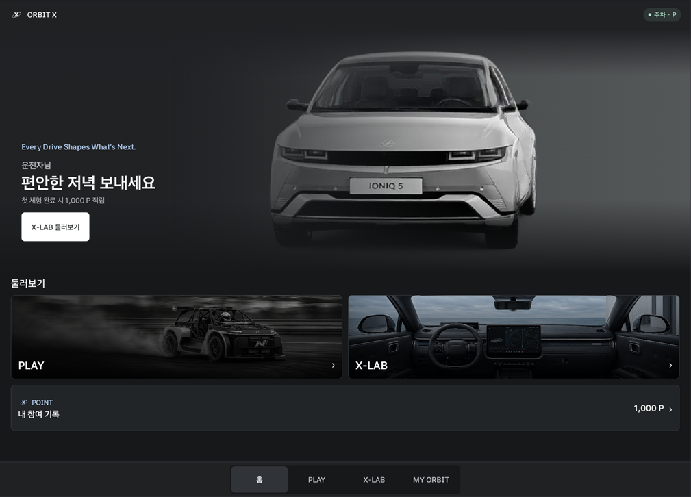 | 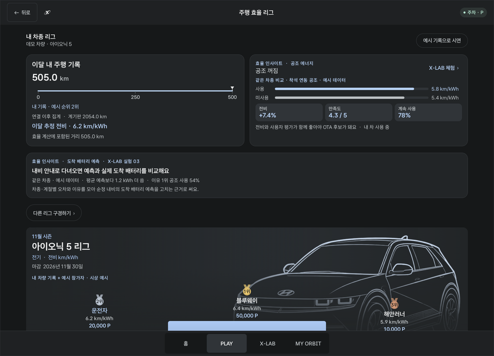 |
| 슬로건과 인사말, PLAY·X-LAB 진입, 포인트 | 이달 505 km로 순위 등록(이용자 이름 "운전자" 2위), 공조 인사이트·같은 차종 비교(예시), 도착 배터리 예측 카드 |
| **드라이브** | **X-LAB 실험 목록** |
| 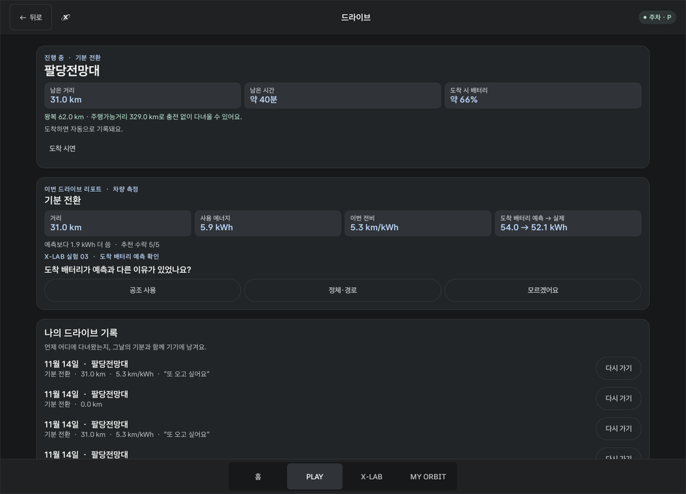 | 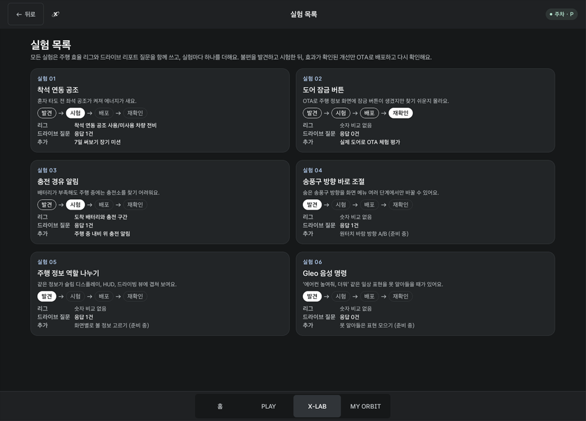 |
| 진행 중 경로(남은 거리·시간·도착 배터리·내비 예상 전비)와 드라이브 리포트(예상 전비 7.8 → 실제 5.3 km/kWh, 도착 배터리 54.0 → 52.1 kWh, 주행 중 측정), 실험 03 질문 | 실험 6개의 단계(발견 → 시험 → 배포 → 재확인)와 연결된 PLAY, 응답 수 |
| **착석 연동 공조** | **도어 잠금 OTA 평가** |
| 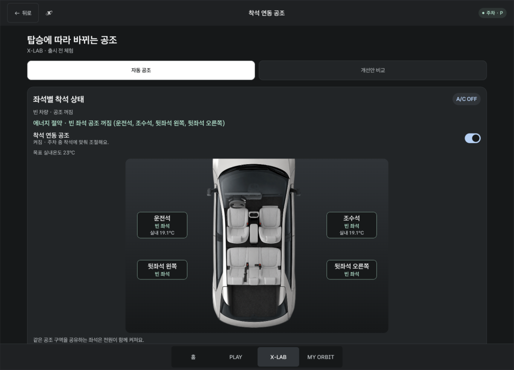 | 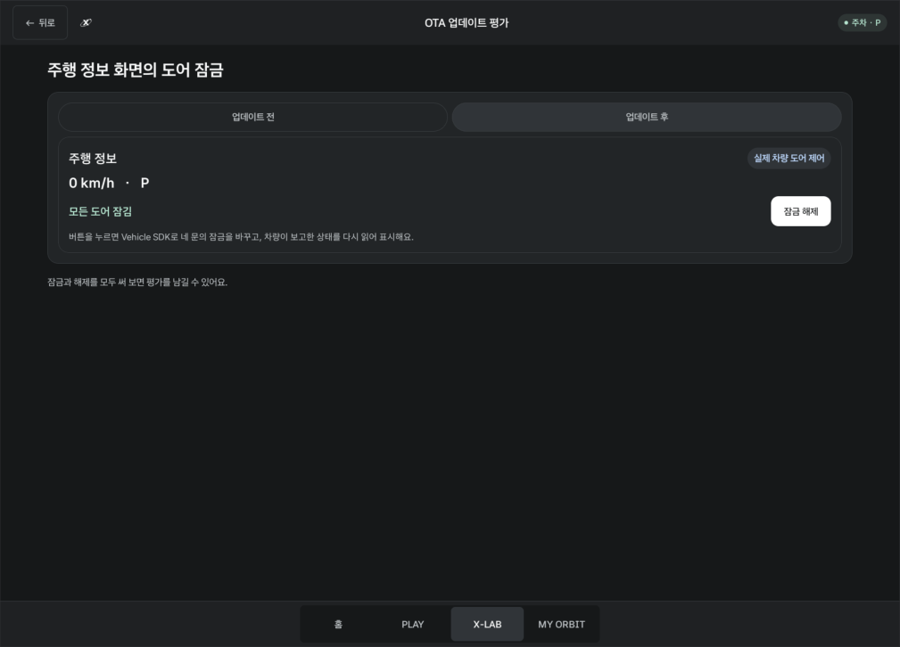 |
| 빈 차량을 감지해 순정 공조를 끄고 "에너지 절약" 표시 | Vehicle SDK로 실제 네 문을 잠그고 풀며 버튼을 평가 |
| **MY ORBIT** | **개선안 비교 (실제 차량 A/B)** |
| 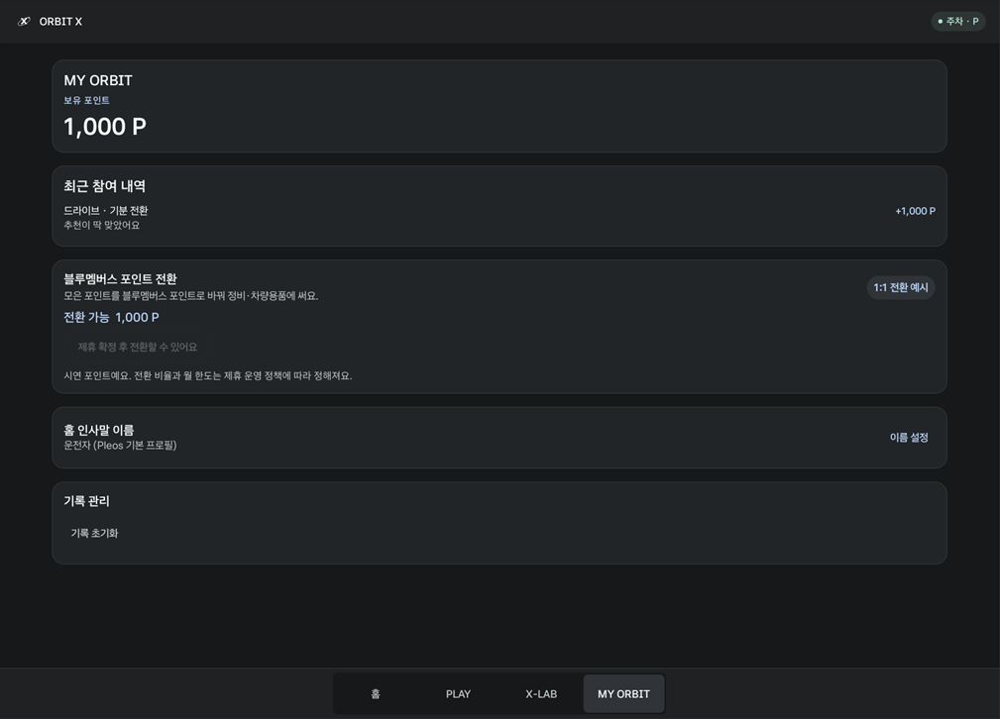 | 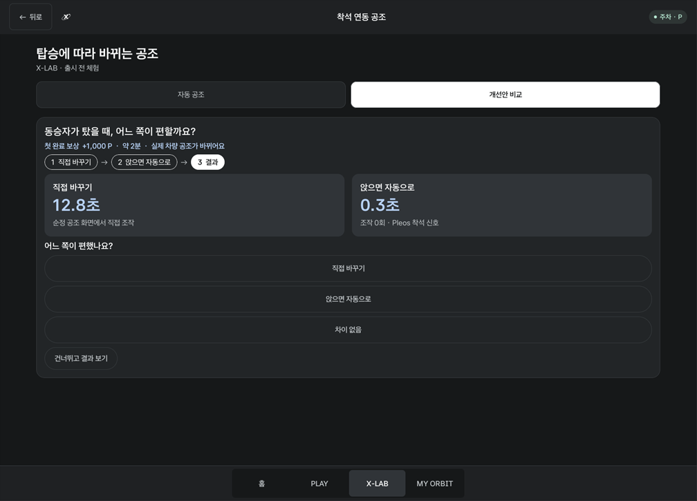 |
| 포인트와 블루멤버스 전환 안내 | 직접 SYNC 켜기(직접 조작) vs 앉으면 자동으로(조작 0회) |

### 주행 중 (기어 D)

| 앱 화면 잠금 | 내비 위 충전 알림 | 알림 버튼 → 충전소 목록 |
| --- | --- | --- |
| 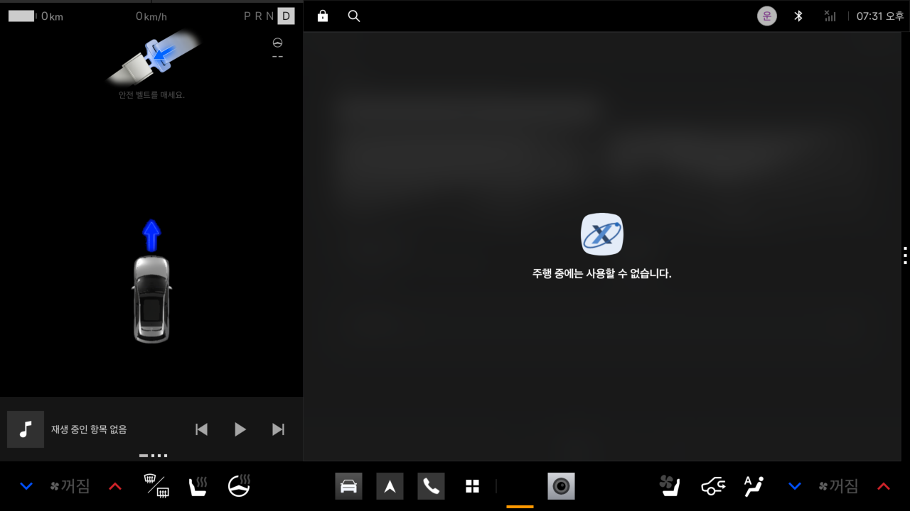 | 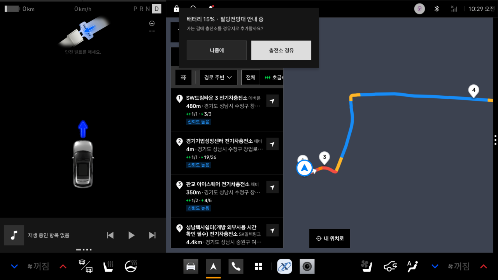 | 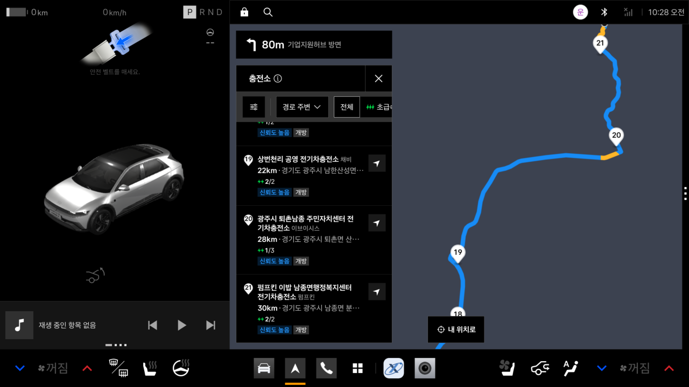 |
| Pleos 주행 제한에 따라 "주행 중에는 사용할 수 없습니다." 표시. P로 돌아오면 다시 조작 | 앱을 열지 않고 내비 위에 안내 (순정 저잔량 안내와 같은 역할) | 경로 주변 충전소를 고르면 내비가 경유지로 추가 |

| 내비 위 주행 습관 안내 | 도착 후 드라이브 리포트의 X-LAB 실험 질문 (기어 P) |
| --- | --- |
| 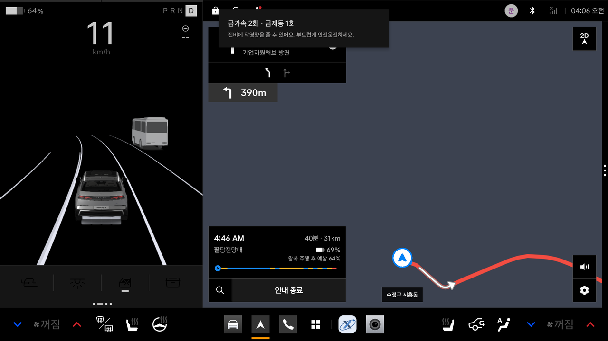 |  |
| 급가속·급제동이 3번 쌓이면 3초만 띄우고 스스로 사라짐. 한 드라이브에 최대 2번 | 실험 질문은 설문이라 내비 위 알림으로 띄우지 않고, 주차 후 앱의 리포트에서 버튼 하나로 답함 |

---

## 기능

표시 기준: **실제 SDK** = 차량·내비에서 실제로 읽거나 제어 · **예시** = 서버 집계가 필요해 시연용 값 사용

### PLAY · 발견

**주행 효율 리그**
- **월간 추정 전비·연비:** 같은 차종끼리 비교합니다. 누적거리와 배터리 에너지로 계산하고 충전 구간은 뺍니다. 내비가 앞에 있어 앱이 뒤로 가도 백그라운드 서비스가 계속 기록합니다. **실제 SDK**
- **순위 등록:** 이달 500 km를 넘으면 내 기록이 **앱 이용자 이름**(기본은 Pleos 프로필 이름 "운전자")으로 순위에 올라갑니다. **실제 SDK** · 다른 참가자·시상액은 **예시**
- **공조 인사이트:** 주차 중 착석과 공조 구역 전원을 읽기 전용으로 확인해, 빈 좌석 공조가 켜져 있으면 앰버색으로 알려 줍니다. **실제 SDK**
- **도착 배터리 예측 카드:** 내 드라이브들의 평균 예측 오차를 보여 줍니다(X-LAB 실험 03). **실제 SDK** · 같은 차종 평균은 **예시**
- **같은 차종 비교:** 착석 연동 공조 사용/미사용 차량의 전비·만족도·계속 사용 비율. 실제 다수 차량 분석이 아니라 서버 집계가 생겼을 때의 화면을 예시 값으로 만든 것입니다. **예시**

**드라이브**
- **출발 전 확인:** 주행가능거리로 왕복 가능 거리, 배터리, 실내온도를 보여 주고, 너무 춥거나 더우면 열선·착석 연동 공조 팁을 줍니다. **실제 SDK**
- **추천과 자동 연결:** 차량 상황으로 드라이브 모드(충전 들르기·동승자와 나들이·편한 경로·기분 전환)를 추천하고, 버튼 하나로 순정 내비 검색을 엽니다. 순정 내비에서 안내를 시작하면 드라이브가 자동 시작되고 목적지가 연결되며, 도착하면 자동으로 기록됩니다. **실제 SDK**
- **경로 에너지 확인:** 남은 거리·시간, 도착 시 예상 배터리, **내비 예상 전비**를 보여 주고, 왕복이 주행가능거리보다 길면 충전소를 제안합니다. **실제 SDK**
- **드라이브 리포트:** 출발·도착 때 읽은 값으로 거리·사용 에너지·전비를 계산합니다. 질문은 한 번에 하나(기분 한 줄 → 추천이 맞았는지 → X-LAB 실험 질문)만 묻고, 실제 목적은 **목적 바꾸기**로 고칩니다. **실제 SDK**
- **나의 드라이브 기록:** 날짜·장소·거리·전비와 기분 한 줄을 남기고, **다시 가기**로 순정 내비 안내를 바로 시작합니다. 최근 20건을 기기에 보관합니다.

**순정 내비 예측 vs 실제 (X-LAB 실험 03)**

현대·기아 순정 내비는 이미 도착 배터리를 예측하고, 모자라면 충전소를 경유지로 넣어 줍니다(EV 경로 플래너). ORBIT X는 이 기능을 다시 만들지 않고, **그 예측이 실제와 얼마나 맞는지와 왜 어긋나는지**를 기록합니다. 드라이브 모드를 고르지 않아도 순정 내비로 안내를 받으면 자동으로 기록됩니다.

| 무엇을 | 어떻게 | 리포트 예 |
| --- | --- | --- |
| 예상 전비 vs 실제 전비 | 출발 때 경로 거리 ÷ (출발 배터리 − 내비 예상 도착 배터리)를 실제 전비와 비교 | 예상 전비 7.8 → 실제 5.3 km/kWh |
| 도착 배터리 예측 vs 실제 | NaviHelper가 준 도착 시 남는 에너지(Wh)를 도착 때 Vehicle SDK 배터리 에너지와 비교 | 54.0 → 52.1 kWh · 예측보다 1.9 kWh 더 씀 |
| 차이의 원인 | 주행 중 차량 속도를 0.5초마다 읽어 급가속(3 m/s² 이상)·급제동(-3.5 m/s² 이하, 브레이크 페달 확인) 횟수, 공조를 켠 시간, 평균 속도를 기록 | 급가속 4회 · 급제동 2회 · 공조 32분(추정 약 0.5 kWh) · 평균 52 km/h |
| 운전자의 이유 | 차이가 나면 한 번만 질문 | 공조 사용 / 정체·경로 / 모르겠어요 |

- 공조 에너지는 평균 1 kW로 가정한 **참고용 추정치**이며, 실제 소비는 외기온·히트펌프에 따라 크게 다릅니다.
- 중간에 충전한 드라이브와 출발 배터리보다 높은 오래된 예측은 비교에서 뺍니다.
- 가속 페달 값은 SDK에 없어 급가속으로 판단합니다. 과속은 일부러 판단하지 않습니다(NaviHelper에 제한속도 이벤트가 있지만, 속도 경쟁을 부추기지 않도록 리그와 리포트에 속도 점수를 넣지 않음).

**주행 중 내비 위 안내**
- **주행 습관 안내:** 급가속·급제동이 한 드라이브에서 3번 쌓이면 "급가속 2회 · 급제동 1회 / 전비에 악영향을 줄 수 있어요. 부드럽게 안전운전하세요."를 **3초만** 띄우고 스스로 사라집니다. 누를 필요가 없고 한 드라이브에 최대 2번(3회, 6회째)만 띄웁니다. **실제 SDK**
- **충전 알림:** 도착 예상 30% 이하 또는 현재 25% 이하이면 알림을 띄우고, 버튼 하나로 경로 주변 충전소 목록을 엽니다. 순정 저잔량 안내와 같은 역할이라 차별 기능으로 내세우지 않습니다. **실제 SDK**

<details>
<summary>드라이브 추천은 어떻게 정하나요?</summary>

주차(P) 중 차량 신호를 5초마다 읽고, 위에서부터 처음 맞는 조건으로 추천합니다.

| 순서 | 조건 (데이터 출처) | 추천 |
| --- | --- | --- |
| 1 | 배터리 25% 이하 (Vehicle SDK SOC) | 충전 들르기 |
| 2 | 조수석 착석 (Vehicle SDK 착석 센서) | 동승자와 나들이 |
| 3 | 평일 출퇴근 시간 (오전 7시–9시, 오후 5시–7시) | 편한 경로 찾기 |
| 4 | 최근 7일 중 3일 이상 같은 목적지 도착 (목적지는 해시로 저장) | 기분 전환 |
| 5 | 그 외 | 기분 전환 |

드라이브마다 **차량 상황**(배터리, 동승, 주행가능거리, 실내온도) + **선택**(추천 모드 vs 실제 목적, 알림 수락 여부, 실제 거리·에너지) + **이유**(추천이 맞았는지, 기분 한 줄)를 한 묶음으로 남기고 추천 수락률을 보여 줍니다. 다음 단계로는 내 이력으로 추천 순서를 기기 안에서 개인화하고, 동의한 기록을 서버에서 차종·상황별로 집계해 개선 과제를 찾는 방향을 제안합니다.

</details>

**미션**
- 데일리·장기 미션으로 기능을 써 보게 합니다. 예를 들어 SYNC 미션은 순정 SYNC를 실제로 켜 본 뒤 그동안 쓰지 않은 이유(몰랐음 / 사용법 모름 / 필요 없음 등)를 묻습니다. **실제 SDK**

| 분류 | 미션 | 시연 보상 |
| --- | --- | ---: |
| 데일리 | 도어 잠금 OTA 평가 | 2,000 P |
| 데일리 | 나에게 맞는 드라이브 | 1,000 P |
| 데일리 | 동승자 탑승 공조 비교 | 1,000 P |
| 데일리 | 앞좌석 온도 동기화 써보기 | 1,000 P |
| 장기 | 착석 연동 공조 7일 써보기 | 3,000 P |

처음 완료할 때의 포인트이며, 드라이브 적립은 주 2회, 앱 내 적립은 월 80,000 P까지입니다.

### X-LAB · 개선안과 시험

- **착석 연동 공조:** 네 좌석의 착석을 읽어 빈 좌석 공조는 끄고, 앉은 좌석은 목표 23°C와 열선·통풍으로 맞춥니다. 모두 비면 순정 공조를 끕니다. 좌석별 풍량을 지원하는 차는 빈 좌석 바람을 가장 약하게(지원 시 0단) 줄이고, 앞좌석 풍량이 하나로 묶인 차(에뮬레이터)는 빈 좌석 온도만 절전으로 맞춥니다. **실제 SDK**
- **개선안 비교(A/B):** "동승자가 탔을 때 앞좌석 온도를 함께 맞추기"를 실제 차로 두 번 합니다.
  1. **직접 바꾸기:** 순정 공조 화면에서 운전자가 SYNC를 켭니다.
  2. **앉으면 자동으로:** 동승석 착석을 감지한 앱이 SYNC를 켭니다.
  3. **결과:** 두 번 모두 차량이 보고한 SYNC 상태로 완료를 확인하고, 운전자가 직접 조작해야 했는지(직접 조작 vs 조작 0회)를 비교한 뒤 선호와 이유를 남깁니다.

  보통 공조는 켜 둔 채 덥거나 추울 때만 조절하므로, 빠르기보다 **동승자가 탔을 때 운전자가 손댈 일이 줄어드는지**를 봅니다. **실제 SDK**
- **도어 잠금 OTA 평가:** 더 뉴 그랜저에 OTA로 추가된 주행 정보 화면 도어 잠금 버튼을 체험합니다. 버튼을 누르면 Vehicle SDK로 **실제 네 문의 잠금**을 바꾸고 차량이 보고한 상태를 다시 읽어 표시한 뒤, 버튼을 찾기 쉬웠는지 평가합니다. P단에서만 동작합니다. **실제 SDK**

### MY ORBIT · 보상

- 참여 기록과 포인트, 블루멤버스 포인트 전환(제휴 후 제공)을 안내합니다.
- 홈 인사말과 리그 순위에는 Pleos 프로필 이름을 기본으로 쓰고, 읽을 수 없으면 "운전자"로 표시합니다. 직접 바꿀 수도 있습니다.
- **기록 관리 → 기록 초기화** `시연용 · 배포 전 제거`

<details>
<summary>왜 블루멤버스 포인트로 바꿔 주나요?</summary>

| 관점 | 이유 |
| --- | --- |
| 운전자 | 앱 안에서만 쓰는 포인트는 쓸 곳이 없어 금방 관심이 식습니다. 이미 쓰는 블루멤버스로 바꾸면 정비·차량용품처럼 차에 실제로 쓰는 혜택이 됩니다. |
| 현대자동차그룹 | 새 포인트 제도나 정산 체계 없이 기존 멤버십을 그대로 씁니다. 지급한 포인트가 그룹 서비스 안에서 쓰이므로 비용이 고객 혜택과 재방문으로 돌아옵니다. |
| 개발팀 | 외부 설문 패널이나 사용성 테스트를 따로 모집하는 대신, 실제 내 차를 쓰는 운전자에게 보상하고 실제 환경의 의견을 받습니다. 포인트 재원은 실험을 의뢰한 조직이 부담합니다. |
| 데이터 품질 | 포인트는 긍정 평가가 아니라 정해진 체험과 응답을 끝낸 데 줍니다. 좋은 점수를 줘야 보상받는 구조가 아니어서 솔직한 응답이 나오고, 월 적립 한도로 보상만 노린 반복 참여를 막습니다. |

</details>

---

## 실험 목록

모든 실험은 **드라이브 리포트 질문**(도착 직후 이유 수집)을 함께 쓰고, 숫자로 볼 수 있는 실험은 **주행 효율 리그**로 효과를 잽니다. 실험마다 PLAY를 하나만 더합니다.

- 드라이브마다 실험 질문을 하나 묻습니다. 내비 안내로 다녀와 도착 배터리 예측과 실제가 다르면 실험 03을, 그 밖에는 나머지 실험을 돌려 가며 묻습니다.
- 질문은 주차 후 앱의 **드라이브 리포트**에서 버튼 하나로 답합니다. 설문은 운전과 관련된 알림이 아니므로 내비 위 알림으로 띄우지 않습니다(Pleos 앱 심사 기준). 응답 수는 **X-LAB → 실험 목록**에 쌓입니다.
- 실험 하나는 설정 묶음(단계, 리그 지표, 드라이브 질문, 추가 PLAY)이라 새 실험을 넣어도 PLAY 화면을 고칠 필요가 없습니다. 운영 단계에서는 이 설정을 서버에서 내려보냅니다.

| 실험 | 불편·낭비 | 리그 | 드라이브 질문 | 추가 PLAY | 단계 |
| --- | --- | --- | --- | --- | --- |
| 01 착석 연동 공조 | 혼자 타도 전 좌석 공조가 켜짐 | 착석 연동 공조 사용/미사용 차량 전비 | 오늘 공조가 쾌적했나요? | 7일 써보기 장기 미션 | 시험 |
| 02 도어 잠금 OTA 평가 | OTA로 생긴 버튼을 찾기 쉬운지 모름 | - | 도어 잠금 버튼을 바로 찾았나요? | 실제 도어로 OTA 체험 평가 | 재확인 |
| 03 도착 배터리 예측 확인 | 순정 내비의 도착 배터리 예측이 실제와 얼마나 맞는지, 왜 어긋나는지 모름 | 차종별 예측·실제 도착 배터리 차이 | 도착 배터리가 예측과 다른 이유가 있었나요? | 드라이브 리포트의 예측 vs 실제 도착 배터리 | 시험 |
| 04 송풍구 방향 바로 조절 | 숨은 송풍구를 화면 메뉴 여러 단계로만 조절 | - | 오늘 바람 방향을 바꾸다 불편했나요? | 원터치 바람 방향 A/B (준비 중) | 발견 |
| 05 주행 정보 역할 나누기 | 같은 정보가 슬림 디스플레이·HUD·드라이빙 뷰에 겹침 | - | 같은 정보가 여러 화면에 보여 헷갈렸나요? | 화면별로 볼 정보 고르기 (준비 중) | 발견 |
| 06 Gleo 음성 명령 | "에어컨 높여줘, 더워" 같은 일상 표현 인식 실패 | - | Gleo가 못 알아들은 말이 있었나요? | 못 알아들은 표현 모으기 (준비 중) | 발견 |

단계는 발견 → 시험 → 배포 → 재확인 순서이며, 효과가 없으면 보류·중단합니다.

---

## 실행 방법

1. Android Studio에서 저장소 루트를 열고 SDK Manager에서 **Android SDK API 37**과 **Platform-Tools**를 설치합니다. 첫 Gradle 동기화에는 Pleos SDK를 내려받을 네트워크가 필요합니다.
2. [Pleos 공식 개발 가이드](https://document.pleos.ai/docs/connect/guide/getting-started/application-development/use-vehicle-emulator)에 따라 Pleos 가상 기기를 준비하고 실행합니다.
3. 빌드하고 설치합니다.

```powershell
.\gradlew.bat :app:testDebugUnitTest :app:assembleDebug
adb install -r --user 10 app/build/outputs/apk/debug/app-debug.apk
adb shell am start --user 10 -n com.example.orbitx/.MainActivity
```

첫 실행 때 **알림**과 **차량 속도** 권한을 허용합니다(차량 속도는 급가속·급제동 측정에 씁니다). 사용자 번호는 `adb shell am get-current-user`로 확인합니다. Windows 기본 SDK 경로는 `%LOCALAPPDATA%\Android\Sdk`입니다.

| 빌드 환경 | |
| --- | --- |
| 앱 빌드 | Kotlin · Jetpack Compose · Gradle Wrapper 9.6.0 · Gradle 데몬 JVM 25 |
| Android SDK | compile/target API 37 · min API 28 (빌드 SDK와 에뮬레이터 이미지 버전은 별개) |
| 화면 배치 | 2560 × 1440 전체 화면과 Pleos 분할 화면(앱 영역 축소) 모두에 맞춰 배치 |

<details>
<summary>순정 내비가 "서비스 연결 중"에서 멈출 때</summary>

에뮬레이터는 PC의 DNS 서버 목록을 그대로 씁니다. VMware·VPN 등 가상 어댑터의 DNS가 앞에 있으면 내비 게이트웨이 주소를 찾지 못해 순정 내비가 연결되지 않습니다. 에뮬레이터를 공개 DNS로 다시 시작합니다.

```powershell
& "$env:LOCALAPPDATA\Android\Sdk\emulator\emulator.exe" -avd Pleos_Connect_v2.1.0 -no-snapshot-load -dns-server 8.8.8.8,1.1.1.1
```

</details>

---

## 시연 가이드

### Virtual Console 연결

```powershell
adb forward tcp:8088 tcp:8088
```

PC 브라우저에서 [Pleos Virtual Console](http://127.0.0.1:8088/)을 열고 **Emulation Controls**에서 아래 카드를 조작합니다. 콘솔 하단에 "DDS OFFLINE"이 보이면 페이지를 새로고침합니다. [콘솔 카드 가이드](https://document.pleos.ai/docs/pleos-only/app-test-guide/virtual-console-guide)

| 확인할 기능 | 콘솔 카드 | ORBIT X 화면 |
| --- | --- | --- |
| 추정 전비·순위 등록 | **Motion → Odometer**, **Energy → Battery Energy** (이달 500 km 이상) | PLAY → 주행 효율 리그 |
| 충전 구간 제외 | **Energy → Charge Switch**, **Battery Energy** | PLAY → 주행 효율 리그 |
| 빈 좌석 공조 낭비 | **Climate → HVAC Power**(콘솔 메인 CLIMATE 패널의 Power), **Convenience → Seat Occupancy** | 리그 인사이트, X-LAB → 착석 연동 공조 |
| 동승자 추천·공조 | **Convenience → Seat Occupancy** | PLAY → 드라이브, X-LAB → 착석 연동 공조 |
| 저잔량 추천·충전 알림 | **Energy → Battery SOC** (25% 이하) | PLAY → 드라이브, 내비 안내 중 알림 |
| 예상 전비·도착 배터리 vs 실제 | 내비 안내 시작 후 **Gear Selection** D, **Odometer**·**Battery Energy** 변경, 다시 P | PLAY → 드라이브 리포트 |
| 급가속·급제동, 주행 습관 안내 | 기어 D에서 콘솔 메인 화면의 ACCEL·BRAKE 패널로 속도를 0 ↔ 60 km/h로 빠르게 바꾸고, 줄일 때 **Motion → Brake Pedal** (3번이면 안내) | 내비 위 3초 안내, 드라이브 리포트 |
| 왕복 가능 거리 | **Energy → Remaining Range**, **Battery Energy** | PLAY → 드라이브 |
| 실제 도어 잠금 | 앱의 **모든 도어 잠그기**. 결과는 **Convenience → Door Lock**과 Pleos 상단 자물쇠 아이콘 | X-LAB → 도어 잠금 OTA 평가 |
| 주행 제한 | **Motion → Gear Selection** P → D → P | 모든 화면 |

**3분 시연 순서**
1. 리그에서 빈 좌석 공조 낭비 발견
2. X-LAB 착석 연동 공조로 빈 좌석 공조 끄기(실제 공조 OFF), A/B 비교
3. 도어 잠금 OTA 평가로 실제 도어 잠금
4. 드라이브에서 내비 안내 시작(자동 시작·연결, 내비 예상 전비)
5. 기어 D에서 앱 잠금, 급가속·급제동 3번이면 내비 위 3초 안내
6. P로 돌아와 도착 → 리포트의 예상 전비·도착 배터리 vs 실제와 주행 중 측정

<details>
<summary>상세 절차: 리그 추정 전비와 순위 등록</summary>

1. **PLAY → 주행 효율 리그**를 띄우고 기어는 **P**에 둡니다. **Energy → Battery Energy**를 **60.0 kWh**로 설정하고 약 5초 기다립니다.
2. **Motion → Odometer**를 현재 계기판 값보다 **12 km 높게**, **Battery Energy**를 **58.0 kWh**로 바꿉니다. 두 변경은 30초 안에 적용합니다.
3. **이달 추정 전비**가 **12 km ÷ 2.0 kWh = 6.0 km/kWh**로 표시됩니다. 기존 측정이 있으면 월간 합계에 더해집니다.
4. 충전 시연: **Charge Switch → On**, **Battery Energy 77.0 kWh**, **Charge Switch → Off** 순서로 바꾸면 충전 구간은 전비에서 빠집니다.
5. 순위 등록: 충전과 주행(예: Odometer +250 km, Battery Energy −40 kWh)을 반복해 이달 500 km를 넘기면, 내 기록이 이용자 이름으로 아이오닉 5 리그 순위에 올라갑니다.

- 월간 추정 전비 = 유효 구간 거리 합계 ÷ 같은 구간 배터리 순사용량 합계. 충전 중 샘플과 15초 넘게 끊긴 구간은 뺍니다.
- Odometer에 HTTP 400이 뜨면 앱의 계기판 값보다 큰 정수 km를 입력합니다. 누적거리는 줄일 수 없습니다.
- 가솔린·하이브리드는 **연료량 읽기 허용** 후 AAOS `FUEL_LEVEL`로 km/L를 계산합니다. 연료량을 제공하는 차량이나 별도 환경이 필요합니다.
- 순위만 빠르게 보려면 **예시 기록으로 시연 → 예시 주행 +24 km**를 씁니다.

</details>

<details>
<summary>상세 절차: 드라이브, 주행 중 안내, 예측 vs 실제</summary>

1. 기어 **P**에서 **PLAY → 드라이브**를 엽니다. 추천 카드의 버튼(예: 수변공원 찾기)으로 순정 내비 검색을 열고 목적지를 고릅니다. 다른 모드는 **다른 모드 고르기**에서 고릅니다.
2. 내비에서 안내가 시작되면 ORBIT X 드라이브가 자동으로 시작되고, 남은 거리·시간·도착 배터리·내비 예상 전비가 보입니다.
3. 기어를 **D**로 바꾸고 콘솔 메인 화면의 ACCEL·BRAKE 패널로 속도를 빠르게 올렸다 내리기를 3번 하면 내비 위에 3초짜리 주행 습관 안내가 뜹니다. **Climate → HVAC Power**를 켜면 공조 시간도 기록됩니다.
4. 충전 알림을 보려면 **Energy → Battery SOC**를 25% 이하로 낮추고 안내를 시작한 뒤 기어 **D**로 바꿉니다. **충전소 경유**를 누르면 경로 주변 충전소 목록이 열립니다.
5. 예: 배터리 **58.0 kWh**에서 안내를 시작하고, **Odometer**를 경로 거리만큼 올리고 **Battery Energy**를 내비 예측보다 조금 낮게 바꾼 뒤 **P**로 돌아와 **도착 시연**을 누릅니다. 리포트에 "예상 전비 7.8 → 실제 5.3 km/kWh · 예측보다 1.9 kWh 더 씀"과 주행 중 측정이 나옵니다.

</details>

<details>
<summary>상세 절차: 착석 연동 공조와 A/B 비교</summary>

1. 기어 **P**에서 **X-LAB → 착석 연동 공조 → 자동 공조**를 열고 스위치를 켭니다.
2. 콘솔 **Convenience → Seat Occupancy**에서 좌석을 **Empty / Occupied**로 바꾸며 좌석 표시와 **A/C ON/OFF**를 확인합니다. 같은 공조 구역을 공유하는 좌석은 함께 반응합니다.
3. **개선안 비교 → 비교 시작**: ① 순정 공조 화면(또는 콘솔 메인 CLIMATE 패널의 **Sync**, 카드 이름 HVAC Dual)에서 SYNC를 켜면 다음 단계로 넘어갑니다. ② 조수석을 **Occupied**로 바꾸면(또는 **동승자 탑승 시연**) 앱이 SYNC를 켭니다. ③ 결과를 보고 선호와 이유를 고릅니다.
4. 장기 미션 첫날은 착석 구역 공조가 켜진 상태로 이 화면을 **1분** 유지하면 기록됩니다.

</details>

---

## 데이터와 개인정보

- 모든 기록은 **앱 전용 저장소에만** 보관합니다. **서버로 전송하거나 현대차그룹에 전달하는 기능은 없습니다.**
- 앱이 뒤에서 기록하는 동안에는 "ORBIT X 주행 기록 중" 알림이 표시됩니다. 앱을 닫고 주차 상태로 드라이브·내비 안내 없이 2분이 지나면 기록을 멈춥니다(할 일이 없을 때 백그라운드 서비스를 유지하지 않도록 한 Pleos 가이드 반영).
- 연속 GPS 경로, 카메라 영상, 음성은 수집하지 않습니다. 주행 중 속도는 급가속·급제동 횟수와 평균 속도를 계산하는 데만 쓰고 원본은 저장하지 않습니다.
- 반복 방문 비교에는 목적지 해시만 씁니다(익명화를 보장하는 값은 아님). 드라이브 기록의 장소와 좌표는 **다시 가기**를 위해 기기에만 최근 20건 보관합니다.
- **MY ORBIT → 기록 관리 → 기록 초기화**로 지울 수 있습니다. `시연용 · 배포 전 제거`

<details>
<summary>기능별로 쓰는 데이터</summary>

| 기능 | 얻는 데이터와 출처 | 기기에 남기는 내용 |
| --- | --- | --- |
| 홈·MY ORBIT | Pleos 프로필 이름(읽을 수 있을 때), 사용자가 입력한 이름, 공조 자동화 설정 | 직접 입력한 이름과 설정 |
| 주행 효율 리그 | 차량 모델, 누적거리, 배터리 에너지·충전 스위치, 지원 차량 연료량, 착석·공조 전원(읽기 전용) | 월별 거리 기준점, 효율 계산 거리·소비량 합계, 도착 배터리 예측 오차 평균 |
| 드라이브 | 배터리 SOC·에너지, 주행가능거리, 실내온도, 조수석 착석, 차량 속도, 브레이크 페달, 공조 전원, 내비 목적지·남은 거리·도착 배터리·도착 이벤트 | 진행 중 목적지, 리포트, 추천 수락 기록, 드라이브 기록(최근 20건), 목적지 해시와 방문일(7일), 예측·실제 도착 배터리(kWh), 내비 예상 전비, 주행 중 측정(급가속·급제동 횟수, 공조 시간, 평균 속도) |
| 착석 연동 공조 | 네 좌석 착석, 실내온도, 공조 구역 상태 | 자동화 설정, 장기 미션 완료일·의견 (연속 신호 이력은 저장 안 함) |
| X-LAB A/B 비교 | SYNC 상태(차량 신호)로 확인한 두 방식의 완료와 운전자 조작 여부, 착석 신호 출처, 선호와 이유 | 최근 실험 결과 |
| OTA 평가·미션 | 도어 잠금 상태·제어, SYNC 상태 변경, 평가와 미사용 이유 | 평가 결과, 미션 응답과 포인트 |
| 아이디어·피드백 | 제출 유형과 직접 쓴 의견 | 최근 12건 |

</details>

---

## 향후 차량 개발에 어떻게 쓰나요?

아래 활용은 향후 제안이며, 현재 프로토타입은 서버로 수집하지 않습니다.

| 개발팀이 답할 질문 | 비교할 지표 | 결과를 쓰는 예 |
| --- | --- | --- |
| 새 기능이 기존 방식보다 편한가? | 과제 완료율, 운전자 조작 필요 여부·횟수, 오류·중단 비율, 선호와 이유 | 자동 전환이 편해도 오작동 우려가 많으면 적용 조건과 상태 표시부터 고쳐 다시 비교 |
| 순정 기능의 예측이 맞는가? | 차종·계절별 내비 예상 전비·도착 배터리와 실제의 차이, 급가속·급제동·공조 사용과의 관계 | 공조나 운전 습관에서 오차가 커지면 예측 모델에 그 요인을 반영하도록 개선 과제로 넘김 |
| 기능을 왜 안 쓰는가? | 미사용 이유 비율 (몰랐음 / 사용법 모름 / 필요 없음) | 몰랐다면 노출 위치, 어려웠다면 안내, 필요가 낮다면 기능 우선순위를 재검토 |
| 첫 체험 뒤에도 계속 쓰는가? | 서로 다른 날의 사용 횟수, 7일 완료율, 계속 쓸 의향 | 첫날만 좋고 이어지지 않으면 반복 사용 중 불편을 점검 |
| OTA 뒤 무엇을 고쳐야 하나? | 버전별 버튼 발견율, 완료율, 불편·만족 응답 | 버튼은 유용한데 못 찾는다면 기능을 빼지 않고 위치와 아이콘을 수정 |
| 다음에 무엇을 실험할까? | 제안 주제의 빈도, 문제 상황, 차종·기능 범위 | 여러 차종에서 반복되면 공통 UI 후보, 특정 옵션에서만 생기면 차종별 과제 |

- **동의와 최소 수집:** 서버 단계에서는 체험과 데이터 제공을 구분하고, 전송 전에 항목·목적·보관 기간을 안내합니다. 실험 ID·버전·과제 결과·선택형 응답 등 판단에 필요한 항목만 보내고, 이름·VIN·원본 목적지와 경로·좌석 신호 연속 기록은 보내지 않습니다.
- **보상 구조:** 체험과 응답을 끝내면 포인트를 주고, 블루멤버스 포인트로 바꿔 그룹 서비스에서 쓰게 합니다.

---

## 구현 범위와 SDK

| 연동 | 사용하는 신호와 기능 |
| --- | --- |
| Pleos Vehicle SDK 2.3.2 | 기어, 네 좌석 착석, 공조 구역 읽기·제어(빈 좌석 공조 끄기), 실내온도, 누적거리, 주행가능거리, 배터리 잔량·에너지·충전 스위치, **도어 잠금 상태 읽기·제어**, 브레이크 페달 상태, 차량 제공 효율 참고값 |
| Pleos NaviHelper 3.0.5 | 순정 내비 화면 요청, **앱에서 경로 안내 시작(`requestRoute`)**, 최근 목적지, 경로 시작·남은 거리·시간·도착 시 예상 에너지(Wh 단위), 목적지 자동 연결, 도착 이벤트 |
| Android Automotive OS | 주행 제한(UX Restrictions), 차량 모델, 지원 차량 연료량, 차량 속도(`PERF_VEHICLE_SPEED`, `CAR_SPEED` 런타임 권한), 내비 위 알림. Pleos API 호환성 문서가 안내하는 AAOS 표준 프로퍼티로, `CarPropertyManager`로 지원 여부를 확인한 뒤 읽습니다. |

| 구분 | 내용 |
| --- | --- |
| **실제 동작** | 착석 연동 공조, 빈 좌석 공조 감지·끄기, 실제 도어 잠금, 추정 전비와 순위 등록, 드라이브 추천·자동 연결·리포트, 내비 예상 전비·도착 배터리 vs 실제, 급가속·급제동·공조 시간·평균 속도 측정, 내비 위 주행 습관 안내·충전 알림, 리포트의 실험 질문, 앱이 뒤에 있을 때의 백그라운드 기록, 주행 제한 잠금, 다크·라이트 모드 |
| **앱 내 재현·예시** | 리그의 다른 참가자·시상액, 같은 차종 사용/미사용 비교 수치, 도착 배터리 예측의 같은 차종 평균, 내비 없이 하는 모의 도착 |
| **현대자동차그룹 연계가 필요한 부분** | OTA 배포와 배포 판단, 서버 집계와 실제 참여자 리그, 블루멤버스 실제 전환 |
| **검증 환경 한계** | Pleos Connect v2.1.0 에뮬레이터는 공조 전원이 전 좌석 한 구역이고 앞좌석 풍량도 하나로 묶여 있어(1–8단, 0단 없음), 빈 좌석만 바람을 끄는 동작은 확인하지 못했습니다. 실제 차량은 좌석별 풍량을 지원하므로 같은 코드가 빈 좌석 풍량을 가장 약하게(지원 시 0단) 내립니다. 순정 내비의 출발 위치는 에뮬레이터에서 고정입니다. |
| **향후 계획** | 휴게·동승자 코스 알림, 음성(TextToSpeech·Gleo) 안내, 실차 연료량 기반 연비 검증 |

월간 전비 계산은 신호가 따로 도착하는 경우, 충전 구간을 빼는 경우, 신호가 끊겼다가 다시 들어오는 경우를 단위 테스트로 검증합니다. 도착 배터리 비교는 예측보다 더 쓴 경우·덜 쓴 경우, 예측이 없는 경우, 중간 충전으로 비교에서 빠지는 경우를, 주행 중 측정은 저장·복원과 값이 빠진 경우를 검증합니다.

[Pleos Connect SDK](https://document.pleos.ai/en/api-reference/connect-sdk-pleos) · [NaviHelper](https://document.pleos.ai/api-reference/connect-sdk-pleos/NaviHelper/intro) · [공모전 제출 안내](https://appdevchallenge.auto-hmg.io/guide/submission)
